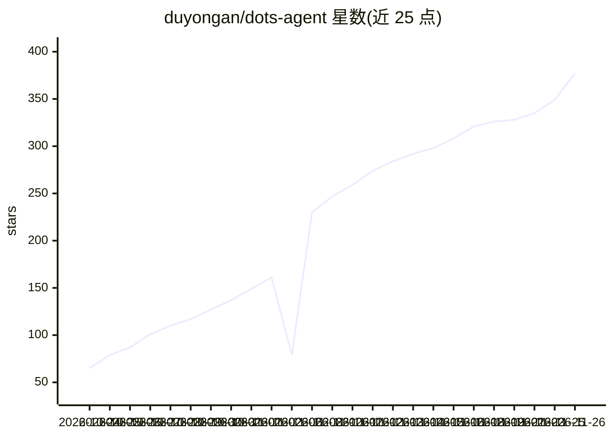

# duyongan/dots-agent

⭐ 377 · Python · MIT · 推送 2026-11-08 · [GitHub](https://github.com/duyongan/dots-agent) · 个人维护 · 中文 README

**给开发者的主动值守智能体：自主发现任务并执行**

以 Python 包与 Windows 桌面程序两种形态提供的智能体：后台循环每 60 秒轮询事件源，主动派生目标并执行，覆盖需求分析到开发测试的全流程流水线、本体库元数据采集与派生、MCP 外部系统接入（飞书/Jira/GitLab/Sigma）及微信群 BUG 监控。动作经审批规则闸门（ask/allow/deny），结论需附证据否则进入待复核状态。需要配置模型 API key 方可联网运行。

## 筛选速览

| 维度 | 判定 | 备注 |
|---|---|---|
| AI 角色 | `ai-native` | 本体是模型或模型工具 |
| 许可风险 | `permissive` | MIT |
| 部署形态 | `desktop` | 安装包/桌面程序 |
| 模型依赖 | locked-api |  |
| 硬件要求 | — | 无带数字的原话,不猜 |
| 安装摩擦 | `low` | 无编译、无系统依赖或容器化 |
| 成熟度 | — | 结构信号不足 |

## 能力要点

- 后台循环主动发现任务并派生目标，七种目标状态含证据复核机制
- 动作级审批闸门：邮件、shell 等按规则 ask/allow/deny
- 技能库：从执行中总结可复用流程，渐进披露描述
- MCP 接入飞书/Jira/GitLab/Sigma；本体库从 PG/MySQL/Mongo 采元数据派生文档与代码

## 适用场景

- 让 agent 值守监控微信群报错并自动开修复流水线
- 把一条需求从头送到尾：分析→设计→开发→测试→归档
- 从公司数据库采集元数据维护本体库并同步派生产物

## 场景标签

`编码 Agent` · 领域:编码与开发

## 证据(README 行号)

> L3: 一个会主动发现任务、主动积累技能的智能体。
> L9: - **全流程流水线**:需求分析 → 原型设计 → 开发 → 测试 → 修复 → 归档,阶段推进看产物不看嘴。
> L215: 循环默认在界面启动时自动开启。它的存在感就是「主动」:不用你喊,它每轮自己找活干。

## 星数曲线

2026-10-24 65 → 2026-11-26 377（+312）

---
*卡片 v1 · prompt 1.4 · 生成 2026-11-25 · 置信度 high · 依据 README sha `3401417fb9b8` · [字段定义](../../DATASET.md)*
