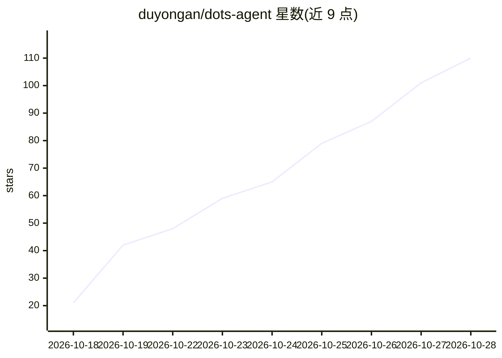

# duyongan/dots-agent

⭐ 117 · Python · MIT · 推送 2026-10-20 · [GitHub](https://github.com/duyongan/dots-agent) · 个人维护 · 中文 README

**主动发现任务并积累技能的自主智能体，配命令行与桌面界面**

包名 dots-agent、命令 dots 的自主智能体：每轮 tick 扫描事件源（工作区文件、IMAP 邮件、iCalendar）发现任务，生成目标并执行，执行中把可复用流程总结为 SKILL.md 技能。带审批闸门（allow/ask/deny 规则、邮件或按钮批准、超时按拒绝）、多 bot 交接、每日 token 预算与证据核验（无证据的完成进入待复核）。模型支持 DeepSeek/Kimi/通义/智谱/豆包/硅基流动/Claude/OpenAI/Gemini，密钥只引用环境变量名。提供 pip 安装、Windows 桌面安装包（自带嵌入式 Python）与网页界面；桌面版要求先有 dot.toml 配置否则后端退出。

## 筛选速览

| 维度 | 判定 | 备注 |
|---|---|---|
| AI 角色 | `ai-native` | 本体是模型或模型工具 |
| 许可风险 | `permissive` | MIT |
| 部署形态 | `desktop` | 安装包/桌面程序 |
| 模型依赖 | locked-api |  |
| 硬件要求 | — | 无带数字的原话,不猜 |
| 安装摩擦 | `low` | 无编译、无系统依赖或容器化 |
| 成熟度 | — | 结构信号不足 |

## 能力要点

- 事件源轮询驱动：文件/IMAP/iCal 事件自动转为可执行目标
- 技能库渐进披露：SKILL.md 由 agent 自行总结、整理与删改
- 审批闸门三态规则（allow/ask/deny），超时未批自动按拒绝处理
- Windows 安装包自带嵌入式 Python，无 Python 环境可运行

## 适用场景

- 让 agent 定时盯收件箱或工作区目录，自动接活处理
- 给 agent 派长期目标，在桌面窗口里审批它的敏感动作
- 把常用处理流程沉淀为技能，逐步积累自动化能力

## 场景标签

`Agent 框架` `工作流自动化` · 领域:Agent 开发

## 证据(README 行号)

> L3: 一个会主动发现任务、主动积累技能的智能体。
> L586: 1. **收事件**:`sources.poll_all()` 扫描事件源(工作区文件、IMAP 邮件、iCalendar),

## 星数曲线

2026-10-18 21 → 2026-10-28 110（+89）

---
*卡片 v1 · prompt 1.4 · 生成 2026-10-24 · 置信度 high · 依据 README sha `f8444a6a8f0e` · [字段定义](../../DATASET.md)*
