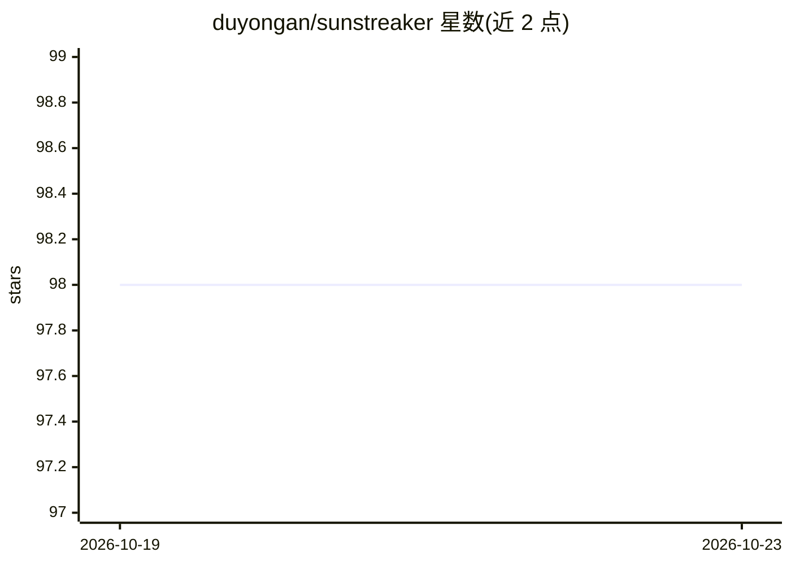

# duyongan/sunstreaker

⭐ 98 · Python · Apache-2.0 · 推送 2026-10-20 · [GitHub](https://github.com/duyongan/sunstreaker) · 个人维护 · 中文 README

**基于 JAX 的类 Keras 深度学习框架，供学习与实验**

以 JAX 为后端、API 风格类似 Keras 的深度学习框架，支持序贯式与函数式建模、compile/fit/save 训练流程、模型结构打印与损失/评价可视化。内置 Dense/Conv2D/GRU/各类归一化等层、多种损失与优化器，并新增 Qwen3/Qwen3-MoE 纯 JAX 实现（KV cache、生成、AdamW 全参微调与 LoRA 微调，权重名与 HuggingFace 一致）。README 明确声明用于学习与实验、切勿用于生产；分布式训练大模型为未完成目标。安装依赖 jax 0.12.0 与 Python 3.12+。

## 筛选速览

| 维度 | 判定 | 备注 |
|---|---|---|
| AI 角色 | `ai-ecosystem` | LLM/agent 周边工具 |
| 许可风险 | `permissive` | Apache-2.0 |
| 部署形态 | `library` | 以包/库形式分发 |
| 模型依赖 | — | README 未给出锁定关系 |
| 硬件要求 | — | 无带数字的原话,不猜 |
| 安装摩擦 | `medium` | 含编译或系统依赖之一 |
| 成熟度 | `idea` | |

## 能力要点

- 类 Keras 的序贯式/函数式建模与 compile/fit/save 流程
- Qwen3/Qwen3-MoE 纯 JAX 实现，支持生成、KV cache、微调与 LoRA
- 模型结构打印（summary/plot_model）与训练可视化
- 从 HuggingFace（默认 hf-mirror）或本地目录加载 safetensors 权重

## 适用场景

- 学习深度学习算法源码与复现论文
- 快速实验新的模型改进想法
- 加载 Qwen3 开源权重做推理与 LoRA 微调实验

## 场景标签

`微调` `模型训练` · 领域:训练与推理

## 证据(README 行号)

> L9: - [x] 源码清晰简洁，利于算法学习与实验
> L111: model.compile(loss=categorical_crossentropy, optimizer=RMSProp(lr=0.001), metrics=[categorical_accuracy])
> L118: 纯 JAX 实现，权重名称与 HuggingFace 保持一致，支持 Dense 与 MoE 模型、KV cache、生成与微调。

## 星数曲线

2026-10-19 98 → 2026-10-23 98（+0）

---
*卡片 v1 · prompt 1.4 · 生成 2026-10-23 · 置信度 high · 依据 README sha `debef366f45a` · [字段定义](../../DATASET.md)*
