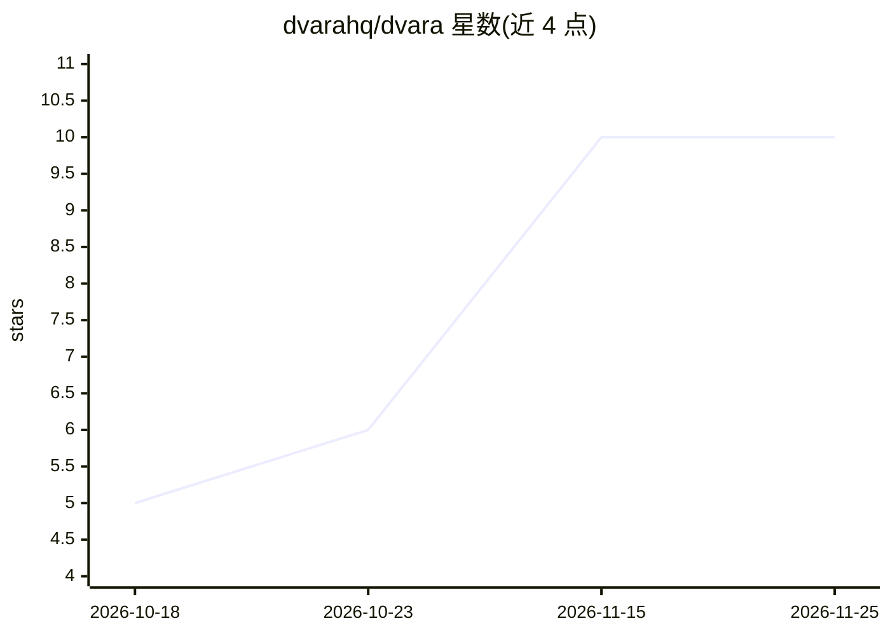

# dvarahq/dvara

⭐ 10 · Java · Apache-2.0 · 推送 2026-11-23 · [GitHub](https://github.com/dvarahq/dvara) · [官网](https://dvarahq.com) · 组织维护

**给开发者的 LLM 调用治理网关：策略、PII、审计**

位于应用与模型提供方之间的开源网关，应用将 OpenAI 兼容 base URL 指向网关即可接入。请求经过策略即代码、PII 检测与脱敏、护栏、限流，并写入 HMAC 链式防篡改审计日志。支持 15 家提供方、模型前缀路由、重试熔断、流式与缓存，可经 Docker 或 JDK 25 上的 jar 运行，也可作为 Spring Boot starter 嵌入。开源仓库为 Apache-2.0；完整平台（工具调用与 agent 流量治理、控制台）不在仓库内，需另行获取。

## 筛选速览

| 维度 | 判定 | 备注 |
|---|---|---|
| AI 角色 | `ai-ecosystem` | LLM/agent 周边工具 |
| 许可风险 | `permissive` | Apache-2.0 |
| 部署形态 | `self-host` | docker 或自建部署 |
| 模型依赖 | local-ok | 支持本地模型 |
| 硬件要求 | — | 无带数字的原话,不猜 |
| 安装摩擦 | `low` | 无编译、无系统依赖或容器化 |
| 成熟度 | — | 结构信号不足 |

## 能力要点

- 策略即代码：按工作区对模型、max_tokens、工具名做拒绝或警告规则
- PII 检测与脱敏：邮箱、卡号、证件号等，支持阻断/脱敏/记录
- HMAC 链式防篡改审计日志及离线校验器
- 一个 API 接入 15 家提供方，支持模型前缀路由、轮询、加权与金丝雀

## 适用场景

- 让应用不改代码地接入多家 LLM 提供方并统一治理
- 拦截提示注入并按策略脱敏请求中的敏感信息
- 为 LLM 调用保留可校验完整性的审计记录
- 接入 Claude Code、Codex CLI、Gemini CLI 等工具的模型流量

## 场景标签

`模型网关` · 领域:Agent 开发

## 证据(README 行号)

> L5:  An open-source, OpenAI-compatible gateway that governs every model call.
> L21: DVARA sits between your application and its model providers. Your application points its OpenAI
> L118: - **One API, 15 providers**, with routing by model prefix, round-robin, weighted split or canary.

## 星数曲线

2026-10-18 5 → 2026-11-25 10（+5）

---
*卡片 v1 · prompt 1.4 · 生成 2026-11-19 · 置信度 high · 依据 README sha `10b78190c4e0` · [字段定义](../../DATASET.md)*
