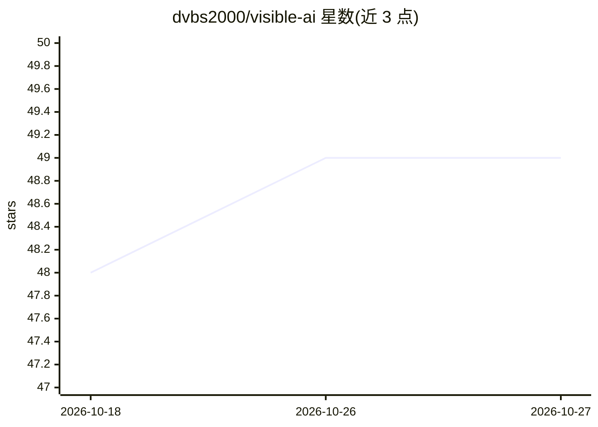

# dvbs2000/visible-ai

⭐ 49 · HTML · NOASSERTION · 推送 2026-06-22 · [GitHub](https://github.com/dvbs2000/visible-ai) · [官网](https://dvbs2000.github.io/visible-ai/) · 个人维护 · 中文 README

**零基础 AI 通识图解电子书：30 章带普通人从神经元学到搭应用**

面向无数学与编程基础的普通读者的 AI 通识书，30 章分 6 阶段，覆盖神经元、Transformer、LLM 训练、RAG、Agent、扩散模型到本地跑 Ollama、手写 RAG 等实战。以 100+ 张原创插画与矢量流程图讲解概念，用元元×小满两个角色问答贯穿，每章采用“破题-工具箱-自测”闭环结构。提供手机在线阅读版与 384 页完整版 PDF，声明永久免费，采用 CC BY-NC-ND 4.0 许可（禁止商用与演绎），另有英文版。

## 筛选速览

| 维度 | 判定 | 备注 |
|---|---|---|
| AI 角色 | `ai-knowledge` | 知识聚合/清单类 |
| 许可风险 | `none` | NOASSERTION |
| 部署形态 | `None` |  |
| 模型依赖 | — | README 未给出锁定关系 |
| 硬件要求 | — | 无带数字的原话,不猜 |
| 安装摩擦 | `low` | 无编译、无系统依赖或容器化 |
| 成熟度 | — | 结构信号不足 |

## 能力要点

- 6 阶段 30 章，从基础概念到调 API、本地跑 Ollama、手写 RAG 的实战
- 100+ 张原创插画与矢量流程图讲解注意力、扩散、梯度下降等概念
- 提供手机翻页在线版、384 页完整 PDF 与英文版，声明永久免费
- CC BY-NC-ND 4.0 许可：可免费下载阅读转发，禁止商用与修改后分发

## 适用场景

- 零基础普通人系统了解 AI 概念与机制
- 入门后按实战章节学习调 API、本地跑模型和写 RAG
- 看懂新模型与热词新闻背后的架构、训练与应用层差异

## 场景标签

`教程课程` · 领域:学习与行业

## 证据(README 行号)

> L5: ### 一本全图解、零基础到亲手构建的 AI 通识书 —— 永久免费
> L20: 市面上讲 AI 的东西，要么是给工程师看的论文，要么是只会喊"颠覆""炸裂"的标题党。**这本书是给"想真正搞懂 AI 到底怎么回事"的普通人写的**——不需要数学基础、不需要会编程，跟着两个角色 **元元 × 小满** 一路爬山

## 星数曲线

2026-10-18 48 → 2026-10-27 49（+1）

---
*卡片 v1 · prompt 1.4 · 生成 2026-10-25 · 置信度 high · 依据 README sha `6bd9601ad563` · [字段定义](../../DATASET.md)*
