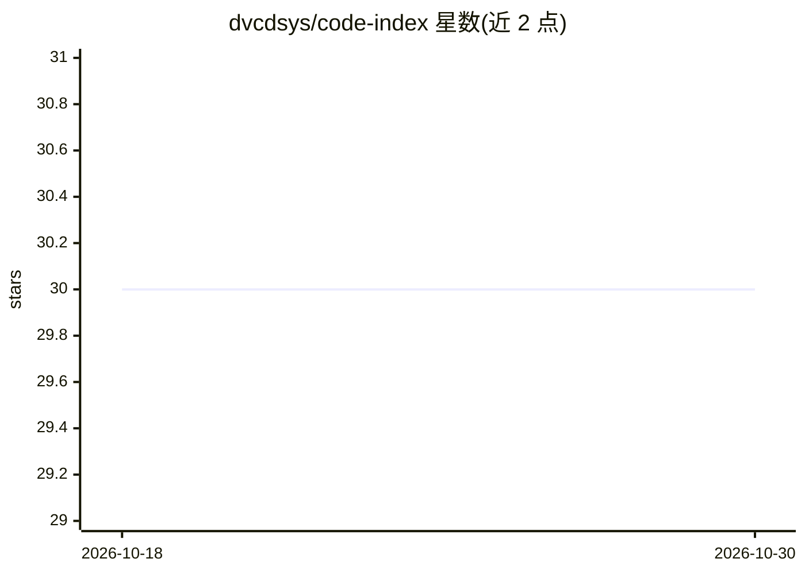

# dvcdsys/code-index

⭐ 30 · Go · MIT · 推送 2026-10-13 · [GitHub](https://github.com/dvcdsys/code-index) · [官网](https://codeindex.app) · 组织维护

**自托管语义代码搜索平台，供开发者与 AI agent 按含义检索代码**

cix 是自托管的语义代码搜索平台：Go 服务器内嵌 llama.cpp sidecar，用 CodeRankEmbed 模型将代码嵌入向量，混合 BM25+稠密检索，返回带文件路径与行号的排位片段。交付形态包括单容器服务器、内嵌 Web 仪表盘、macOS 菜单栏应用、CLI 与文件监听增量索引。支持多仓库 workspace 联合检索、GitHub webhook 自动重建索引，嵌入后端可切换 Voyage AI 或 OpenAI 兼容端点（切换需全量重建）。提供 Claude Code 与 Codex 插件，让 agent 用 cix 替代 Grep 调用。默认本地嵌入，代码不出本机。

## 筛选速览

| 维度 | 判定 | 备注 |
|---|---|---|
| AI 角色 | `ai-ecosystem` | LLM/agent 周边工具 |
| 许可风险 | `permissive` | MIT |
| 部署形态 | `desktop` | 安装包/桌面程序 |
| 模型依赖 | local-ok | 支持本地模型 |
| 硬件要求 | — | 无带数字的原话,不猜 |
| 安装摩擦 | `low` | 无编译、无系统依赖或容器化 |
| 成熟度 | — | 结构信号不足 |

## 能力要点

- 混合 BM25 + 稠密向量检索，向量存于 SQLite 按需扫描，空闲内存为数十 MB 量级
- 默认内嵌 llama.cpp 本地嵌入（CodeRankEmbed），可选 Voyage AI / OpenAI 兼容端点
- 多仓库 workspace 联合检索，GitHub webhook 推送自动重建索引
- Claude Code / Codex 插件使 agent 以 cix 替代 Grep/Glob 做代码检索

## 适用场景

- 在大规模代码库中按语义而非文件名查找实现
- 让 Claude Code / Codex 等 agent 减少扫描无关文件的 token 消耗
- 团队自托管部署，对多个仓库做统一的语义搜索

## 场景标签

`语义搜索` · 领域:知识与检索

## 证据(README 行号)

> L20: **cix — CodeIndeX.** Search your codebase by meaning, not just text. A self-hosted semantic code-search platform — 
> L165: `cix` is designed to be called by AI agents (Claude, GPT, Cursor, custom agents) as a shell tool — they run `cix s

## 星数曲线

2026-10-18 30 → 2026-10-30 30（+0）

---
*卡片 v1 · prompt 1.4 · 生成 2026-10-26 · 置信度 high · 依据 README sha `d5a456288740` · [字段定义](../../DATASET.md)*
