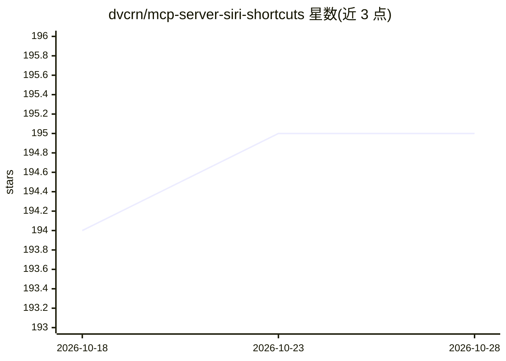

# dvcrn/mcp-server-siri-shortcuts

⭐ 195 · TypeScript · GPL-3.0 · 推送 2026-10-25 · [GitHub](https://github.com/dvcrn/mcp-server-siri-shortcuts) · 个人维护

**让 LLM 通过 MCP 调用 macOS Siri 快捷指令的服务器**

基于 Model Context Protocol 的服务器，向 LLM 暴露 macOS 快捷指令（Shortcuts）功能：提供 list_shortcuts、open_shortcut、run_shortcut 三个基础工具，并自动为系统中每条快捷指令生成独立的动态工具，可传入文本或文件路径输入。底层调用 macOS shortcuts CLI 命令。面向希望让 AI 客户端（如 Claude）操作本机快捷指令的开发者，通过配置 mcpServers 接入；支持环境变量控制动态工具生成与快捷指令列表注入。仅适用于 macOS。

## 筛选速览

| 维度 | 判定 | 备注 |
|---|---|---|
| AI 角色 | `ai-ecosystem` | LLM/agent 周边工具 |
| 许可风险 | `viral` | GPL-3.0 |
| 部署形态 | `None` |  |
| 模型依赖 | — | README 未给出锁定关系 |
| 硬件要求 | — | 无带数字的原话,不猜 |
| 安装摩擦 | `low` | 无编译、无系统依赖或容器化 |
| 成熟度 | — | 结构信号不足 |

## 能力要点

- 三个基础工具：列出/打开/运行快捷指令
- 为每条快捷指令自动生成动态工具
- 底层调用 macOS shortcuts CLI
- 支持文本与文件路径输入

## 适用场景

- 让 Claude 等 MCP 客户端直接运行我的 macOS 快捷指令
- 通过对话触发本机自动化流程
- 让 LLM 发现系统上可用的快捷指令列表

## 场景标签

 · 领域:LLM 工具接入/macOS 自动化

## 证据(README 行号)

> L3: This MCP server provides access to Siri shortcuts functionality via the Model Context Protocol (MCP). It allows list
> L72: - Uses the macOS `shortcuts` CLI command under the hood

## 星数曲线

2026-10-18 194 → 2026-10-28 195（+1）

---
*卡片 v1 · prompt 1.4 · 生成 2026-10-23 · 置信度 high · 依据 README sha `9b6c00cafaa6` · [字段定义](../../DATASET.md)*
