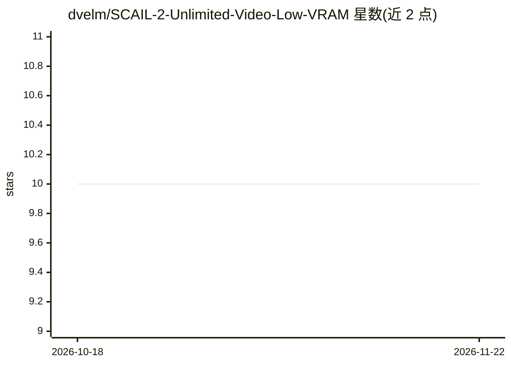

# dvelm/SCAIL-2-Unlimited-Video-Low-VRAM

⭐ 10 · Python · MIT · 推送 2026-08-23 · [GitHub](https://github.com/dvelm/SCAIL-2-Unlimited-Video-Low-VRAM) · 个人维护

**为低显存 GPU 提供单图驱动无限长视频生成的工作流**

基于 ComfyUI 的 SCAIL-2（Wan 2.1 14B）GGUF 量化运动迁移工作流与配套自定义节点包：用参考图像配合驱动视频生成人物动画，模型量化后可在 8–12 GB 显卡运行。核心机制是按 81 帧分段、5 帧锚点重叠自动串联生成，实现不限时长视频，并支持续接上一次运行。提供单节点配置面板（时长/fps/分辨率/种子/模式等），安装无需改代码，需 ComfyUI 0.33.1+ 及若干配套节点包。

## 筛选速览

| 维度 | 判定 | 备注 |
|---|---|---|
| AI 角色 | `ai-native` | 本体是模型或模型工具 |
| 许可风险 | `permissive` | MIT |
| 部署形态 | `None` |  |
| 模型依赖 | — | README 未给出锁定关系 |
| 硬件要求 | `gpu-8g` | |
| 安装摩擦 | `low` | 无编译、无系统依赖或容器化 |
| 成熟度 | — | 结构信号不足 |

## 能力要点

- GGUF 量化（Q3_K_M ≈8.1 GB / Q4_K_M ≈10.9 GB）适配 8–12 GB 显存
- 81 帧分段 + 5 帧锚点自动串联，生成长度不限
- 单配置节点控制全部参数，一次 Queue 自动加载模型与串联分段
- 支持 Animation（保留全部主体）与 Replacement（仅替换被追踪人物）两种模式

## 适用场景

- 用一张人物参考图配驱动视频生成角色动画
- 在 8–12 GB 显存显卡上运行 Wan 2.1 类视频生成
- 生成超过单次显存上限的长视频并续接已完成的运行

## 场景标签

`视频生成` `模型量化` · 领域:内容生成

## 证据(README 行号)

> L3: **Create unlimited-length videos on a low-VRAM GPU (8–12 GB)** — animate any reference image with a driving video us
> L13: - **Unlimited-length videos**: instead of one hard-coded pass (which OOMs low-VRAM cards), the workflow generates i

## 星数曲线

2026-10-18 10 → 2026-11-22 10（+0）

---
*卡片 v1 · prompt 1.4 · 生成 2026-11-20 · 置信度 high · 依据 README sha `fbb29140c84d` · [字段定义](../../DATASET.md)*
