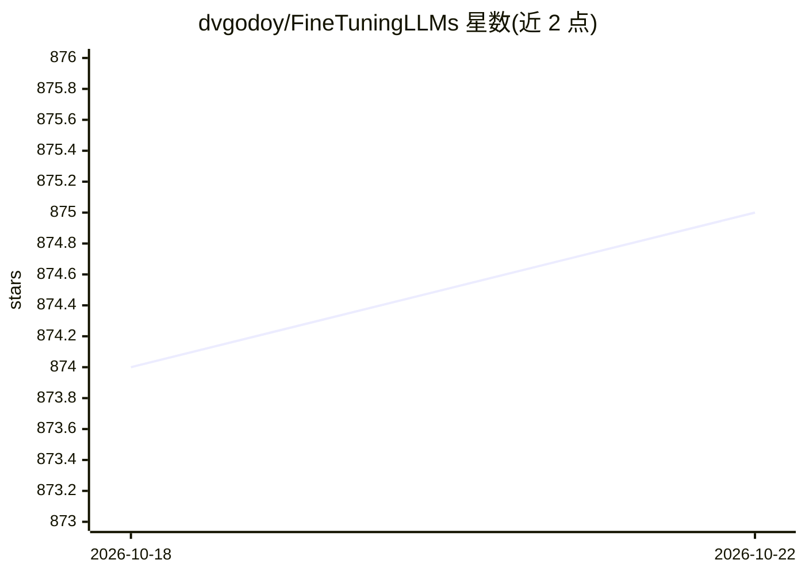

# dvgodoy/FineTuningLLMs

⭐ 876 · Jupyter Notebook · MIT · 推送 2026-02-28 · [GitHub](https://github.com/dvgodoy/FineTuningLLMs) · 个人维护

**微调 LLM 的实战书籍配套仓库：PyTorch 与 Hugging Face 教程**

《A Hands-On Guide to Fine-Tuning LLMs with PyTorch and Hugging Face》一书的官方代码仓库，提供可直接在 Google Colab（GPU）上运行的章节笔记本，覆盖量化模型加载（8-bit/4-bit、BitsAndBytes）、LoRA 低秩适配（PEFT）、数据集格式化与 chat templates、SFTTrainer 训练，以及转换为 GGUF 后用 Ollama 或 llama.cpp 本地部署。面向已掌握 Transformers、attention、GPU 等基础的中级读者，附 GPU Pod 云环境搭建与排错章节。

## 筛选速览

| 维度 | 判定 | 备注 |
|---|---|---|
| AI 角色 | `ai-knowledge` | 知识聚合/清单类 |
| 许可风险 | `permissive` | MIT |
| 部署形态 | `None` |  |
| 模型依赖 | — | README 未给出锁定关系 |
| 硬件要求 | — | 无带数字的原话,不猜 |
| 安装摩擦 | `low` | 无编译、无系统依赖或容器化 |
| 成熟度 | — | 结构信号不足 |

## 能力要点

- 章节笔记本可从 GitHub 直接载入 Colab 用 GPU 运行
- 覆盖量化、LoRA/PEFT、数据格式化、SFTTrainer 微调全流程
- 第 6 章讲解 GGUF 转换并以 Ollama / llama.cpp 本地部署
- 附 Flash Attention 与 SDPA 的速度和内存对比

## 适用场景

- 系统学习在单张消费级 GPU 上微调 LLM
- 按章节动手跑通量化、LoRA 与训练笔记本
- 把微调后的模型转 GGUF 并本地部署推理

## 场景标签

`教程课程` `微调` · 领域:学习与行业

## 证据(README 行号)

> L1: # A Hands-On Guide to Fine-Tuning LLMs with PyTorch and Hugging Face
> L37: I chose the Hugging Face ecosystem as the foundation for this book because it is the _de facto_ standard for workin

## 星数曲线

2026-10-18 874 → 2026-10-22 875（+1）

---
*卡片 v1 · prompt 1.4 · 生成 2026-10-21 · 置信度 high · 依据 README sha `3594f9197c22` · [字段定义](../../DATASET.md)*
