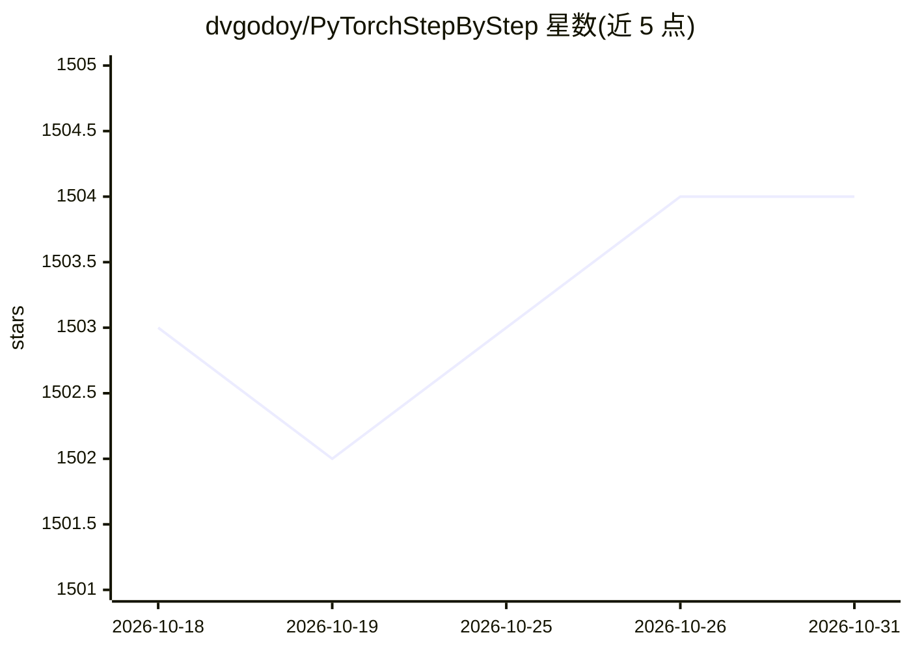

# dvgodoy/PyTorchStepByStep

⭐ 1,504 · Jupyter Notebook · MIT · 推送 2026-02-19 · [GitHub](https://github.com/dvgodoy/PyTorchStepByStep) · [官网](https://pytorchstepbystep.com) · 个人维护

**《Deep Learning with PyTorch Step-by-Step》书的配套代码仓库**

书籍官方代码仓库：为书中每一章提供一个 Jupyter notebook，包含该章全部代码，按顺序运行可复现书中输出。内容覆盖基础训练循环、回归/分类、CNN 与迁移学习、序列模型与 NLP（Part I–IV，含 Chapter 0 可视化梯度下降等）。已针对 PyTorch 2.x 修订并提供各卷变更说明 PDF。提供三种运行方式：Google Colab（GPU）、Binder 云环境、本地 Anaconda+conda 七步安装流程。

## 筛选速览

| 维度 | 判定 | 备注 |
|---|---|---|
| AI 角色 | `ai-knowledge` | 知识聚合/清单类 |
| 许可风险 | `permissive` | MIT |
| 部署形态 | `library` | 以包/库形式分发 |
| 模型依赖 | — | README 未给出锁定关系 |
| 硬件要求 | — | 无带数字的原话,不猜 |
| 安装摩擦 | `medium` | 含编译或系统依赖之一 |
| 成熟度 | — | 结构信号不足 |

## 能力要点

- 每章一个 Jupyter notebook，含全部书中代码且可顺序复现输出
- 内容覆盖 CNN、RNN、迁移学习与 NLP 四大部分
- 针对 PyTorch 2.x 修订并附三卷变更说明
- 支持 Colab / Binder / 本地三种运行方式

## 适用场景

- 按书章节顺序运行代码学习 PyTorch 深度学习
- 不配本地环境，直接在 Colab/Binder 上跑 notebook
- 对比书中输出复现训练结果

## 场景标签

`教程课程` · 领域:学习与行业

## 证据(README 行号)

> L15: This is the official repository of my book "**Deep Learning with PyTorch Step-by-Step**". Here you will find **one 
> L17: Each notebook contains **all the code shown** in its corresponding chapter, and you should be able to

## 星数曲线

2026-10-18 1,503 → 2026-10-31 1,504（+1）

---
*卡片 v1 · prompt 1.4 · 生成 2026-10-21 · 置信度 mid · 依据 README sha `20c6f0decd41` · [字段定义](../../DATASET.md)*
