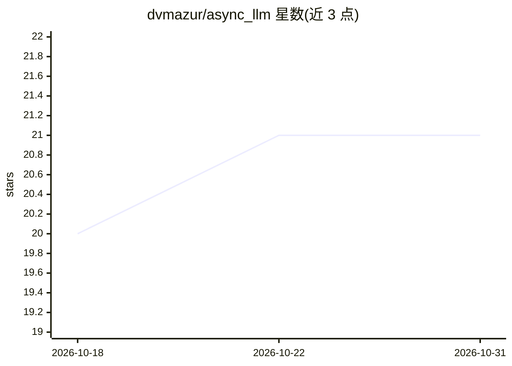

# dvmazur/async_llm

⭐ 21 · Python · MIT · 推送 2026-10-30 · [GitHub](https://github.com/dvmazur/async_llm) · [官网](https://dvmazur.github.io/async_llm/) · 组织维护

**免训练异步 LLM Agent 构建框架，基于共享缓存并发推理**

论文《LLMs are General Asynchronous Agents》的官方实现，用于以 Python asyncio 构建无需任务微调的异步 LLM Agent。核心机制：每个协程写入独立 CacheBlock，通过缓存视图实时读取其他协程的进度，支持全注意力、Gated DeltaNet 与多模态 MRRoPE 层，兼容混合及视觉版 Qwen 3.5+ 模型；推理引擎基于 Mini-SGLang，将所有协程请求合并为均衡批次执行。限制：仅支持 Linux + NVIDIA GPU（CUDA 13.0），部分内核需 JIT 编译并要求 nvcc 与驱动匹配。

## 筛选速览

| 维度 | 判定 | 备注 |
|---|---|---|
| AI 角色 | `ai-ecosystem` | LLM/agent 周边工具 |
| 许可风险 | `permissive` | MIT |
| 部署形态 | `self-host` | docker 或自建部署 |
| 模型依赖 | — | README 未给出锁定关系 |
| 硬件要求 | — | 无带数字的原话,不猜 |
| 安装摩擦 | `low` | 无编译、无系统依赖或容器化 |
| 成熟度 | — | 结构信号不足 |

## 能力要点

- 协程 + CacheBlock + 缓存视图的编程模型，复用 asyncio 原语
- 共享内存推理：一次前向可关注任意有序缓存块列表，支持 Qwen 3.5+ 混合与视觉模型
- 引擎基于 Mini-SGLang，多协程请求合并为均衡批次
- api.forward / api.sample 暴露底层 logits 与采样，可用于探针

## 适用场景

- 让模型边听边想，构建并发思考与输出的 Agent
- 对流式视频或日志做实时反应的 Agent
- 把工作拆分给并行子 Agent 共享推理缓存

## 场景标签

`Agent 框架` · 领域:Agent 开发

## 证据(README 行号)

> L9: AsyncLLM lets you build **training-free asynchronous LLM agents** with Python's `async`/`await`.
> L21:  The engine is built on Mini-SGLang.

## 星数曲线

2026-10-18 20 → 2026-10-31 21（+1）

---
*卡片 v1 · prompt 1.4 · 生成 2026-10-28 · 置信度 high · 依据 README sha `33acbe8783be` · [字段定义](../../DATASET.md)*
