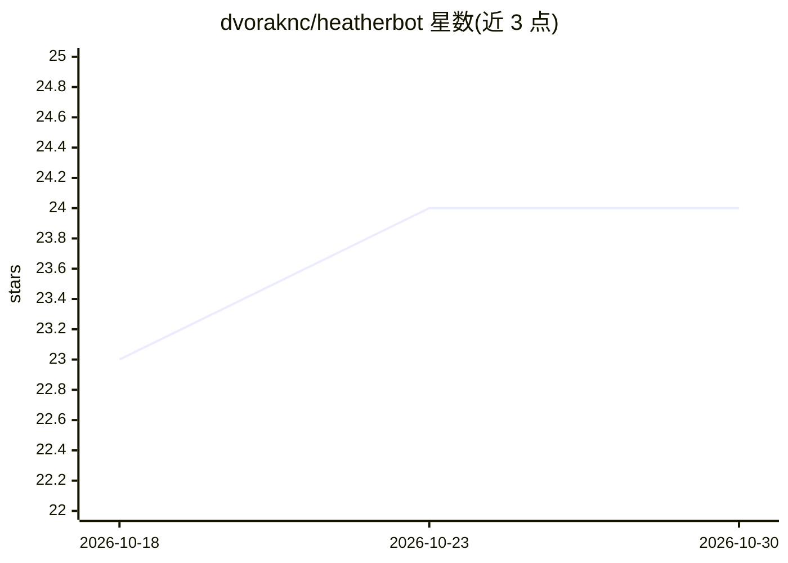

# dvoraknc/heatherbot

⭐ 24 · Python · MIT · 推送 2026-06-21 · [GitHub](https://github.com/dvoraknc/heatherbot) · 个人维护

**全本地 Telegram AI 伴侣 bot：人设 YAML + 本地 LLM，自托管**

基于 Telethon 的 Telegram userbot（MTProto），以本地 llama.cpp（12B GGUF 文本模型）+ persona YAML 驱动角色扮演对话，可选接入 Ollama（LLaVA 图像分析、向量记忆嵌入）、ComfyUI（FLUX.1/SDXL 图像生成、face-swap、LoRA 注入）、Chatterbox TTS 语音消息。提供 17 种自适应偏好人格、四层用户记忆、7 段后处理流水线、Flask 监控面板、Telegram Stars 分层付费与内容安全系统，另有 Discord 桥接。最低需 1 张 24GB VRAM 显卡，推荐双 GPU。可白标换角色，含成人内容声明与 AI 披露机制。

## 筛选速览

| 维度 | 判定 | 备注 |
|---|---|---|
| AI 角色 | `ai-native` | 本体是模型或模型工具 |
| 许可风险 | `permissive` | MIT |
| 部署形态 | `library` | 以包/库形式分发 |
| 模型依赖 | local-ok | 支持本地模型 |
| 硬件要求 | `gpu-24g` | |
| 安装摩擦 | `low` | 无编译、无系统依赖或容器化 |
| 成熟度 | — | 结构信号不足 |

## 能力要点

- persona YAML 定义角色，17 种自适应偏好人格自动检测切换
- 本地 LLM + Ollama 视觉/嵌入 + ComfyUI 图像生成 + TTS 的模块化服务栈
- 四层用户记忆与语义召回，Flask 监控面板与分层付费（Telegram Stars）
- 支持白标换肤：代码与角色无关，人格全部来自 YAML 与媒体资产

## 适用场景

- 在自有硬件上运行完全本地、不依赖云 API 的 Telegram AI 伴侣
- 通过替换 YAML 与媒体资产打造不同角色的白标伴侣 bot
- 同一角色同时部署到 Telegram 与 Discord

## 场景标签

`聊天机器人` `图像生成` `语音合成` · 领域:对话与助手

## 证据(README 行号)

> L3: **A fully local, persona-driven AI companion chatbot for Telegram (with an optional Discord bridge).**
> L5: HeatherBot is a Telegram userbot (MTProto via Telethon) that runs entirely on your own hardware. No cloud APIs, no O
> L24: |llama-server|1234|Yes|Text generation (llama.cpp with any GGUF model)|

## 星数曲线

2026-10-18 23 → 2026-10-30 24（+1）

---
*卡片 v1 · prompt 1.4 · 生成 2026-10-27 · 置信度 mid · 依据 README sha `4edcf0f97bd6` · [字段定义](../../DATASET.md)*
