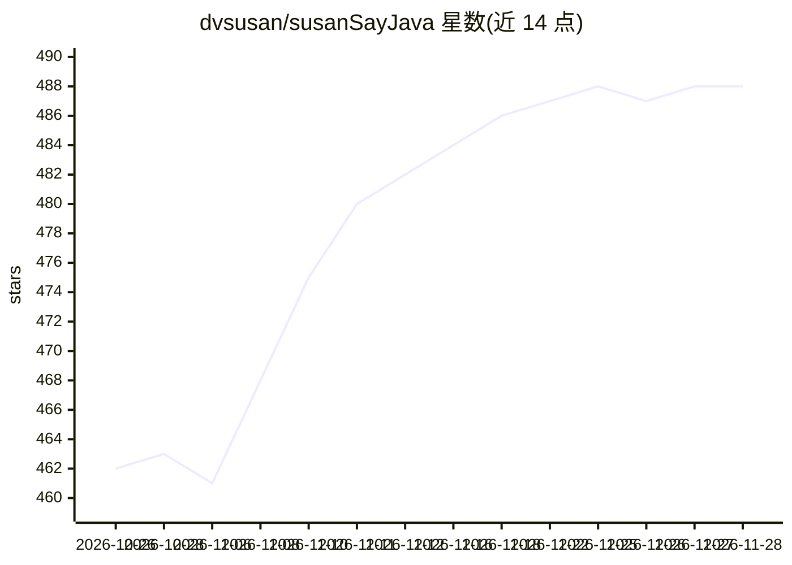

# dvsusan/susanSayJava

⭐ 488 · 推送 2026-11-27 · [GitHub](https://github.com/dvsusan/susanSayJava) · [官网](https://susan.net.cn) · 个人维护 · 中文 README

**Java 后端面试题与项目实战文章合集，含 AI 专题**

以文章目录形式组织的 Java 后端学习与面试资料合集，内容按 AI、高并发、分布式、高可用、Spring、数据库、中间件、缓存、多线程、JVM 等系列分类，附学习路线与 13 个企业级项目实战条目。正文来自作者公众号「苏三说技术」，完整题库与项目源码托管在外部网站 susan.net.cn，并引导加入付费知识星球与技术交流群。仓库本身不含可安装代码。

## 筛选速览

| 维度 | 判定 | 备注 |
|---|---|---|
| AI 角色 | `ai-knowledge` | 知识聚合/清单类 |
| 许可风险 | `none` | — |
| 部署形态 | `None` |  |
| 模型依赖 | — | README 未给出锁定关系 |
| 硬件要求 | — | 无带数字的原话,不猜 |
| 安装摩擦 | `medium` | 含编译或系统依赖之一 |
| 成熟度 | — | 结构信号不足 |

## 能力要点

- 按 18+ 个系列分类的面试题与实战文章目录
- AI 专题覆盖 Claude Code、Spring AI、AgentScope、RAG 等主题文章
- 列出 13 个企业级项目实战条目（含多个 AI Agent 项目）
- 提供 Java 后端学习路线与外部配套网站

## 适用场景

- 准备 Java 后端面试时按系列刷题与查答案
- 想学习 AI Agent 开发的 Java 开发者找入门文章
- 补充高并发、分布式等企业级项目实战经验

## 场景标签

`教程课程` · 领域:学习与行业

## 证据(README 行号)

> L1: # Java 面试八股文与企业级项目实战（持续更新）
> L12: 这里有面试八股文，面试真题，工作经验分享，踩坑日记，学习路线，还有个人成长经历等。
> L27: ## AI相关

## 星数曲线

2026-10-26 462 → 2026-11-28 488（+26）

---
*卡片 v1 · prompt 1.4 · 生成 2026-11-28 · 置信度 high · 依据 README sha `493711d9f7fb` · [字段定义](../../DATASET.md)*
