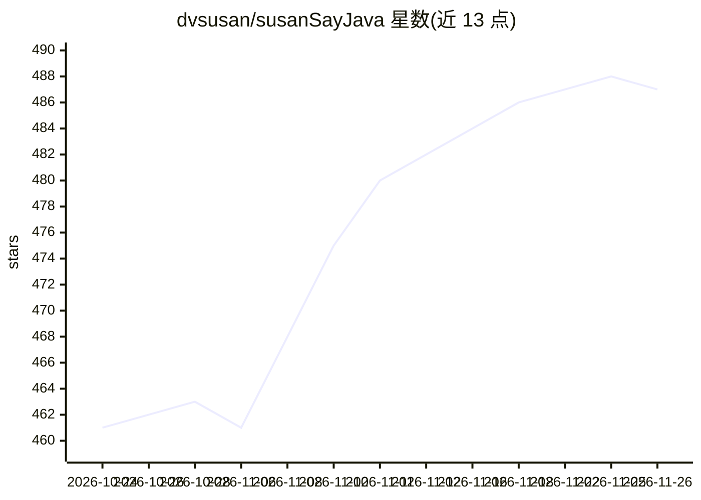

# dvsusan/susanSayJava

⭐ 487 · 推送 2026-11-25 · [GitHub](https://github.com/dvsusan/susanSayJava) · [官网](https://susan.net.cn) · 个人维护 · 中文 README

**面向 Java 后端面试者的中文八股文与项目实战文章合集**

以文章索引为主的中文内容仓库，按 AI、高并发、分布式、高可用、Spring、数据库、中间件、缓存、多线程、JVM、网络等系列组织 Java 后端面试题与经验分享，条目链接指向公众号文章与外部网站 susan.net.cn。另列出 13 个企业级实战项目主题，并通过知识星球提供项目源码与学习路线。仓库本身不含代码与安装方式。

## 筛选速览

| 维度 | 判定 | 备注 |
|---|---|---|
| AI 角色 | `ai-knowledge` | 知识聚合/清单类 |
| 许可风险 | `none` | — |
| 部署形态 | `None` |  |
| 模型依赖 | — | README 未给出锁定关系 |
| 硬件要求 | — | 无带数字的原话,不猜 |
| 安装摩擦 | `medium` | 含编译或系统依赖之一 |
| 成熟度 | — | 结构信号不足 |

## 能力要点

- 按系列组织的 Java 后端面试文章清单（AI、并发、分布式、数据库等）
- 包含 Claude Code、Spring AI、RAG、Agent 等主题的中文教程条目
- 列出 13 个企业级项目实战主题（AI Agent、秒杀、短链等）

## 适用场景

- 准备 Java 后端面试，查找高频面试题与答案
- 想学习 Spring AI / Agent 开发的入门教程路径
- 为简历寻找企业级项目实战方向

## 场景标签

`教程课程` · 领域:学习与行业

## 证据(README 行号)

> L1: # Java 面试八股文与企业级项目实战（持续更新）
> L13: 这里有面试八股文，面试真题，工作经验分享，踩坑日记，学习路线，还有个人成长经历等。
> L28: ## AI相关

## 星数曲线

2026-10-24 461 → 2026-11-26 487（+26）

---
*卡片 v1 · prompt 1.4 · 生成 2026-11-26 · 置信度 high · 依据 README sha `bca5a39593d9` · [字段定义](../../DATASET.md)*
