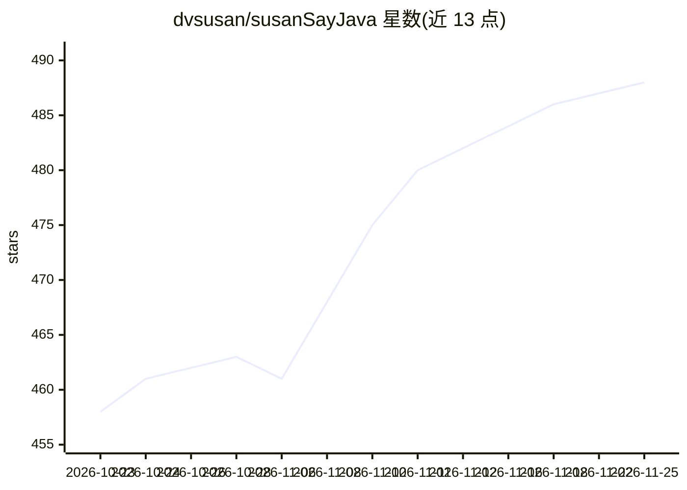

# dvsusan/susanSayJava

⭐ 488 · 推送 2026-11-23 · [GitHub](https://github.com/dvsusan/susanSayJava) · [官网](https://susan.net.cn) · 个人维护 · 中文 README

**Java 面试八股文与后端实战文章合集，覆盖 AI Agent**

由博客作者苏三维护的 Java 后端面试题与文章目录，按高并发、分布式、高可用、Spring、数据库、中间件、缓存、多线程、JVM、网络等主题组织约两百篇文章标题，并附企业级项目实战列表与 AI 相关教程链接。内容指向外部网站 susan.net.cn 与其知识星球，README 本身不包含题解正文，也无安装或运行步骤。面向准备 Java 后端面试和补充项目经验的学习者。

## 筛选速览

| 维度 | 判定 | 备注 |
|---|---|---|
| AI 角色 | `ai-knowledge` | 知识聚合/清单类 |
| 许可风险 | `none` | — |
| 部署形态 | `None` |  |
| 模型依赖 | — | README 未给出锁定关系 |
| 硬件要求 | — | 无带数字的原话,不猜 |
| 安装摩擦 | `medium` | 含编译或系统依赖之一 |
| 成熟度 | — | 结构信号不足 |

## 能力要点

- 按 15+ 主题分类的后端面试文章目录（并发、分布式、MySQL、Redis、MQ 等）
- 13-15 个企业级项目实战条目（秒杀系统、商城微服务、AI Agent 类项目等）
- AI 相关板块：Spring AI、RAG、Agent、Codex、Claude Code 等教程文章链接

## 适用场景

- 准备 Java 后端面试，按主题刷八股文
- 想找企业级项目案例补充简历
- 想入门 Spring AI 和 AI Agent 开发

## 场景标签

`教程课程` · 领域:学习与行业

## 证据(README 行号)

> L1: # Java 面试八股文与企业级项目实战（持续更新）
> L3: Java 后端面试题与项目实战合集：覆盖 Java 基础、JVM、并发编程、Spring、
> L28: ## AI相关

## 星数曲线

2026-10-23 458 → 2026-11-25 488（+30）

---
*卡片 v1 · prompt 1.4 · 生成 2026-11-25 · 置信度 high · 依据 README sha `a21b44e7e8b5` · [字段定义](../../DATASET.md)*
