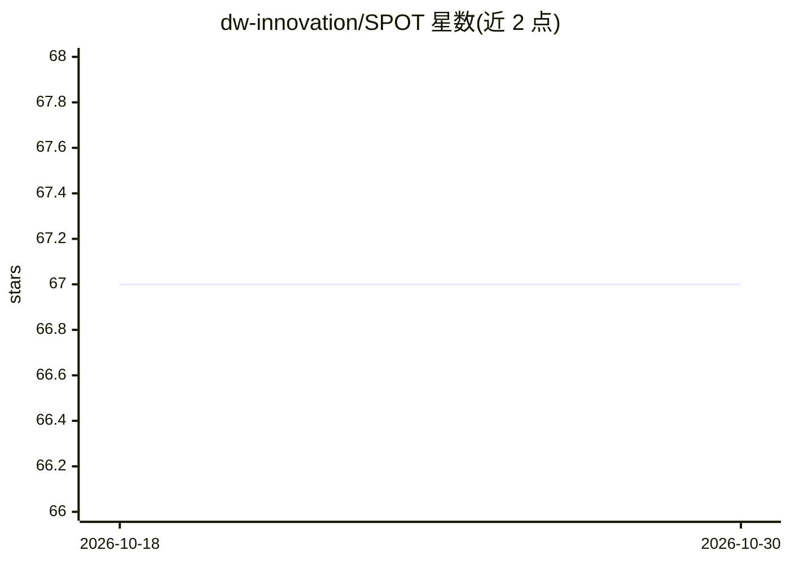

# dw-innovation/SPOT

⭐ 67 · AGPL-3.0 · 推送 2026-09-30 · [GitHub](https://github.com/dw-innovation/SPOT) · [官网](https://www.findthatspot.io) · 组织维护

**自然语言检索 OpenStreetMap 地点的开源地理搜索工具**

SPOT 将用户的自然语言场景描述转换为对 OpenStreetMap 数据的结构化地理空间查询，无需编程或标签知识即可搜索地点并在交互式地图上展示结果。核心机制：微调的开放 LLM（Mistral、LLaMA3）解释场景描述，Elasticsearch 完成 OSM 标签的语义捆绑，再在本地 OSM 数据库上执行空间查询。由多个 Docker 化模块组成（Next.js + Leaflet 前端、NLP API、查询 API、训练脚本等），各模块可独立运行调试。采用 AGPLv3 许可证，由 Deutsche Welle 研究与协作项目维护。

## 筛选速览

| 维度 | 判定 | 备注 |
|---|---|---|
| AI 角色 | `ai-native` | 本体是模型或模型工具 |
| 许可风险 | `viral` | AGPL-3.0 |
| 部署形态 | `self-host` | docker 或自建部署 |
| 模型依赖 | — | README 未给出锁定关系 |
| 硬件要求 | — | 无带数字的原话,不猜 |
| 安装摩擦 | `low` | 无编译、无系统依赖或容器化 |
| 成熟度 | — | 结构信号不足 |

## 能力要点

- 自然语言 → 结构化地理空间搜索，无需标签知识
- 微调开放 LLM（Mistral、LLaMA3）解释场景描述
- 基于 Elasticsearch 的 OSM 标签语义捆绑
- 多模块 Docker 化架构，模块可独立运行调试

## 适用场景

- 用一句话描述场景，在地图上找到匹配的地点
- 地理调查、新闻报道中的地点检索
- 研究者基于其模块（训练脚本、数据生成器）复现或扩展

## 场景标签

`语义搜索` · 领域:知识与检索

## 证据(README 行号)

> L6: SPOT is an open-source tool that lets you search the world using natural language. It turns user queries into geospa
> L14: - 🧠 Fine-tuned open LLMs (Mistral, LLaMA3) interpret scene descriptions
> L15: - 🏷️ Semantic bundling of OSM tags using Elasticsearch

## 星数曲线

2026-10-18 67 → 2026-10-30 67（+0）

---
*卡片 v1 · prompt 1.4 · 生成 2026-10-24 · 置信度 high · 依据 README sha `050f179984ab` · [字段定义](../../DATASET.md)*
