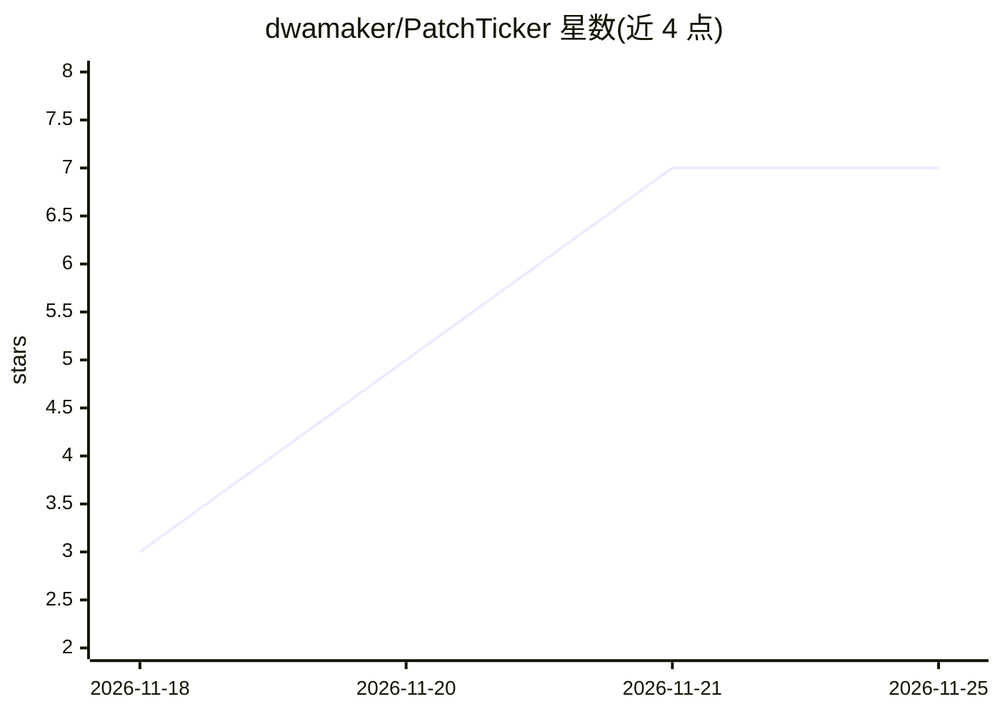

# dwamaker/PatchTicker

⭐ 7 · Python · MIT · 推送 2026-11-22 · [GitHub](https://github.com/dwamaker/PatchTicker) · [官网](https://patchticker.com) · 个人维护

**面向运维者的免登录安全漏洞与补丁实时追踪器（韩文为主）**

从 CVE List、NVD、CISA KEV 及邮件列表、Hacker News 等来源每 10 分钟收集漏洞事件，用户选择自己运行的产品后列表过滤为相关条目；每条事件附风险级别（基于 CISA KEV/攻击报告或 CVSS 分数的规则判定）、CVSS 分数与修复信息。摘要由 AI 从来源生成并经复核，数字与版本不在来源中的摘要会被丢弃重写。无登录、无 cookie，选择仅存于浏览器；提供韩英双语 RSS 订阅与面向 AI agent 的 /api/check JSON 接口。部署在 Cloudflare Pages/R2 上，自托管说明指向 docs/development.md。

## 筛选速览

| 维度 | 判定 | 备注 |
|---|---|---|
| AI 角色 | `ai-enhanced` | 去掉 AI 部分产品仍成立 |
| 许可风险 | `permissive` | MIT |
| 部署形态 | `None` |  |
| 模型依赖 | — | README 未给出锁定关系 |
| 硬件要求 | — | 无带数字的原话,不猜 |
| 安装摩擦 | `low` | 无编译、无系统依赖或容器化 |
| 成熟度 | — | 结构信号不足 |

## 能力要点

- 每 10 分钟从 CVE List、NVD、CISA KEV 等多源收集
- 按用户选择的产品过滤，规则（非 AI）设定风险级别
- AI 生成韩英双语摘要并做来源一致性复核
- 提供 ?products= 参数的 RSS 订阅与 JSON API

## 适用场景

- 追踪自己运行的产品（如 openssh、nginx）相关的最新漏洞与补丁
- 通过 RSS 订阅接收韩文或英文的安全通告
- AI agent 调用 /api/check 查询产品是否受事件影响
- 在 CVE 编号分配前获取邮件列表与新闻中的早期信息

## 场景标签

`网络安全` · 领域:学习与行业

## 证据(README 行号)

> L7:  New security vulnerabilities, sorted by the products you run.
> L79: Summaries are written by AI from these sources only and reviewed once more; one with a number or version not in its
> L96: Collector (Docker, every 10 min)  ──writes──▶  Cloudflare R2 (public JSON)  ◀──reads──  Web page (Cloudflare Pages)

## 星数曲线

2026-11-18 3 → 2026-11-25 7（+4）

---
*卡片 v1 · prompt 1.4 · 生成 2026-11-21 · 置信度 high · 依据 README sha `ab4316ffa359` · [字段定义](../../DATASET.md)*
