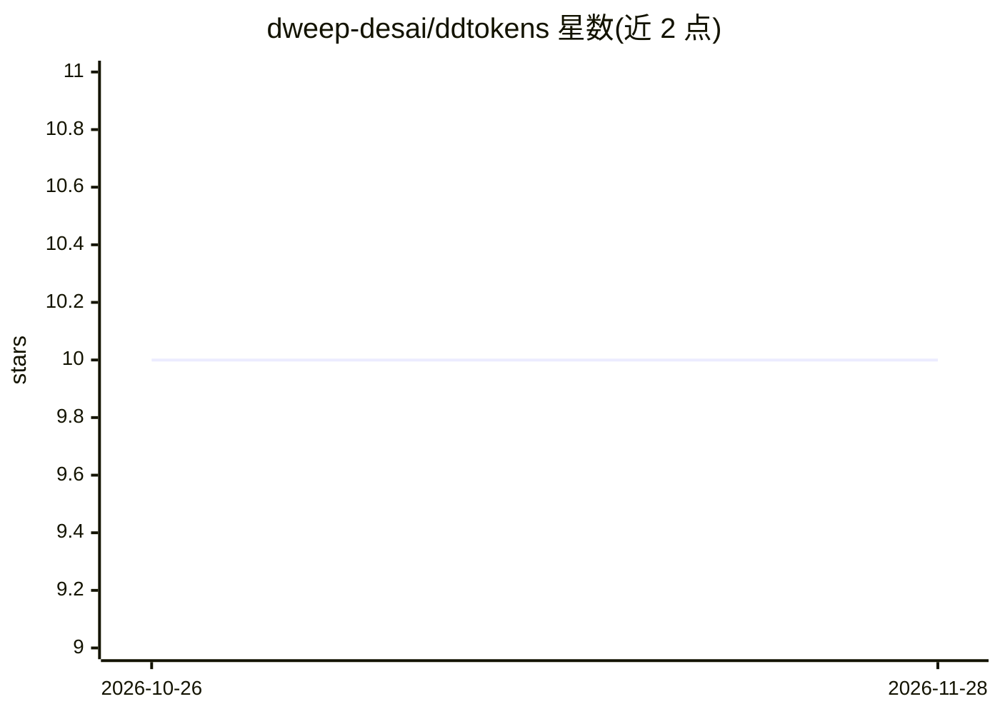

# dweep-desai/ddtokens

⭐ 10 · C++ · 推送 2026-06-12 · [GitHub](https://github.com/dweep-desai/ddtokens) · [官网](https://dweep-desai.github.io/visual-playground-for-ddtokens/) · 个人维护

**个人训练的 byte-level BPE 分词器：复现 LLaMA 2 词表**

作者自训的字节级 BPE 分词器，目标是在 30k 词表规模上复现 LLaMA 2 的词表构建。采用 2023 年提出的堆优化 BPE 训练方法（Max-Heap + 反向索引 + Lazy Deletion），作者称相比朴素逐对扫描方式大幅加快训练。训练数据为 Wikipedia 与 FineWeb（Stack Overflow 因内存限制未最终使用），经清洗后用 C++ 引擎做两阶段训练：单词频率提取与内存内合并循环。输出 merges.ddtok 与 vocab.ddtok 两个文件，并提供可运行的 tokenize_my_text 程序与在线 playground。

## 筛选速览

| 维度 | 判定 | 备注 |
|---|---|---|
| AI 角色 | `ai-native` | 本体是模型或模型工具 |
| 许可风险 | `none` | — |
| 部署形态 | `None` |  |
| 模型依赖 | — | README 未给出锁定关系 |
| 硬件要求 | — | 无带数字的原话,不猜 |
| 安装摩擦 | `medium` | 含编译或系统依赖之一 |
| 成熟度 | — | 结构信号不足 |

## 能力要点

- 基于 Wikipedia + FineWeb 约 200GB 清洗后语料训练的两阶段 BPE 训练流程
- Max-Heap + 反向索引 + Lazy Deletion 的优化合并循环实现
- 遵循 GPT-2/tiktoken 字节级标准（前导空格保留、无 </w> 伪 token）
- 输出 merges.ddtok / vocab.ddtok，附带本地 tokenize 程序与在线 playground

## 适用场景

- 查看并运行该分词器对文本做切分
- 与其他常见分词器在 playground 中对比效果
- 学习堆优化 BPE 训练的实现细节

## 场景标签

 · 领域:NLP/分词器实现

## 证据(README 行号)

> L3: A custom tokenizer (byte level BPE) trained by me to try to replicate LLAMA 2's massive token vocabulary using an op
> L65: the tokenizer is trained using a two-phase approach so it can handle 200+ GB of text on a single machine without ne
> L135: the trained tokenizer spits out two files:

## 星数曲线

2026-10-26 10 → 2026-11-28 10（+0）

---
*卡片 v1 · prompt 1.4 · 生成 2026-11-19 · 置信度 high · 依据 README sha `4c3cf7277b2d` · [字段定义](../../DATASET.md)*
