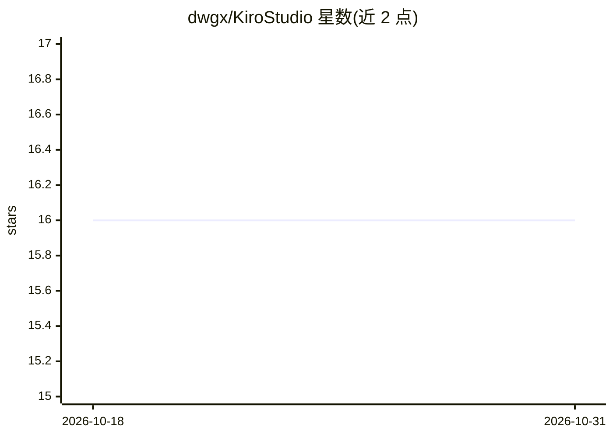

# dwgx/KiroStudio

⭐ 16 · Rust · NOASSERTION · 推送 2026-10-17 · [GitHub](https://github.com/dwgx/KiroStudio) · [官网](https://github.com/dwgx/KiroStudio/releases/latest) · 个人维护 · 中文 README

**把 Kiro/AWS Q 转成 Anthropic 协议的 API 网关，含管理面板**

Rust/Axum 编写的 Anthropic Messages 兼容网关：接收标准 Anthropic API 请求，转换后转发到 Kiro / AWS Q 上游，响应翻译回 Anthropic 格式，任何兼容客户端（如 Claude Code）把 base_url 指向网关即可使用。支持流式/非流式、工具调用、thinking 块与图片输入；多凭据负载均衡（priority/balanced）、故障转移、失败冷却与会话亲和。React 管理面板在编译期嵌入，产物为单二进制；提供网页上号（Social/IdC/External IdP）、用量统计与 API Key 鉴权、IP 白名单、限流等入口安全配置。网关层修复 Claude Code 的 Invalid tool parameters 报错。

## 筛选速览

| 维度 | 判定 | 备注 |
|---|---|---|
| AI 角色 | `ai-ecosystem` | LLM/agent 周边工具 |
| 许可风险 | `permissive` | NOASSERTION |
| 部署形态 | `desktop` | 安装包/桌面程序 |
| 模型依赖 | — | README 未给出锁定关系 |
| 硬件要求 | — | 无带数字的原话,不猜 |
| 安装摩擦 | `low` | 无编译、无系统依赖或容器化 |
| 成熟度 | — | 结构信号不足 |

## 能力要点

- Anthropic Messages 协议与 Kiro / AWS Q 双向转换，支持流式、工具调用、图片输入
- 多凭据负载均衡、故障转移、失败冷却、会话亲和与首字超时换号重开
- 单二进制内嵌 React 管理面板：概览、凭据、用量分析、设置
- 网页上号支持 Social / IdC / External IdP 授权，凭据自动落库

## 适用场景

- 让 Claude Code 等 Anthropic 协议客户端通过 Kiro / AWS Q 上游使用
- 多账号池化调度并查看按模型/凭据/客户端的用量统计
- 通过管理面板网页完成上游凭据授权与运维

## 场景标签

`模型网关` · 领域:Agent 开发

## 证据(README 行号)

> L15: KiroStudio 用 Rust / Axum 编写，接收标准 **Anthropic Messages API** 请求，转换后转发到 **Kiro / AWS Q** 上游，并把上游响应翻译回 Anthropic 格式。任何
> L25: |协议转换|Anthropic Messages `POST /v1/messages` ↔ Kiro / AWS Q，支持流式与非流式、工具调用、thinking 块、图片输入|

## 星数曲线

2026-10-18 16 → 2026-10-31 16（+0）

---
*卡片 v1 · prompt 1.4 · 生成 2026-10-30 · 置信度 mid · 依据 README sha `d58075b0f378` · [字段定义](../../DATASET.md)*
