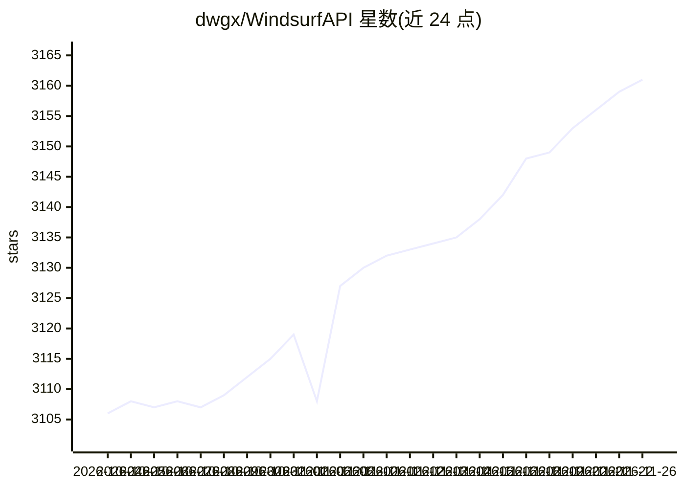

# dwgx/WindsurfAPI

⭐ 3,161 · JavaScript · MIT · 推送 2026-11-25 · [GitHub](https://github.com/dwgx/WindsurfAPI) · [官网](https://dwgx.github.io/WindsurfAPI/) · 个人维护 · 中文 README

**把 Windsurf/Devin 云端模型转为 OpenAI/Anthropic/Gemini 兼容 API 的自托管网关**

自托管 HTTP 反向代理（默认端口 3003），将部署者自己拥有或获授权的 Windsurf/Devin 账号能力翻译为 OpenAI Chat/Completions/Responses、Anthropic Messages、Gemini 四套兼容 API，供 Claude Code、Cline、Cursor、Aider 及各官方 SDK 直接连。请求被翻译为 Windsurf 内部 gRPC 协议经本地 Language Server 发往云端；维护账号池，支持自动轮询、速率限制与故障转移。纯 Node.js 实现、零 npm 运行时依赖，要求 Node 22.13+；提供 Docker 部署与更新回滚脚本；项目不发布 npm 包。README 声明其为独立项目，不提供或出售上游账号凭据。

## 筛选速览

| 维度 | 判定 | 备注 |
|---|---|---|
| AI 角色 | `ai-ecosystem` | LLM/agent 周边工具 |
| 许可风险 | `permissive` | MIT |
| 部署形态 | `library` | 以包/库形式分发 |
| 模型依赖 | — | README 未给出锁定关系 |
| 硬件要求 | — | 无带数字的原话,不猜 |
| 安装摩擦 | `low` | 无编译、无系统依赖或容器化 |
| 成熟度 | — | 结构信号不足 |

## 能力要点

- 同时暴露 OpenAI Chat / Completions / Responses、Anthropic Messages、Gemini 四套兼容端点
- 账号池机制：自动轮询 + 速率限制 + 故障转移
- 纯 Node.js 零 npm 运行时依赖，提供 Docker 部署与一键更新/回滚脚本
- Dashboard OAuth 登录取号、Token 导入与批量导入三种加账号方式

## 适用场景

- 让 Claude Code / Cline / Cursor 通过自定义 Base URL 使用自有的 Windsurf/Devin 账号模型
- 用 OpenAI SDK 或 Gemini SDK 无改代码接入多模型
- 多账号场景下做故障切换与限流隔离

## 场景标签

`模型网关` · 领域:Agent 开发

## 证据(README 行号)

> L54: WindsurfAPI 是一个独立的、开源的、自托管协议兼容网关，用于将部署者**自己拥有或获授权使用的 Windsurf / Devin 账号能力**接入 OpenAI、Anthropic 和 Gemini 兼容客户端。
> L91: 1. 一个 HTTP 服务（端口 3003）同时暴露 OpenAI 和 Anthropic 两套 API
> L92: 2. 把请求翻译成 Windsurf 内部 gRPC 协议，通过本地 Language Server 发给 Windsurf 云

## 星数曲线

2026-10-24 3,106 → 2026-11-26 3,161（+55）

---
*卡片 v1 · prompt 1.4 · 生成 2026-11-26 · 置信度 mid · 依据 README sha `c970c4ed1720` · [字段定义](../../DATASET.md)*
