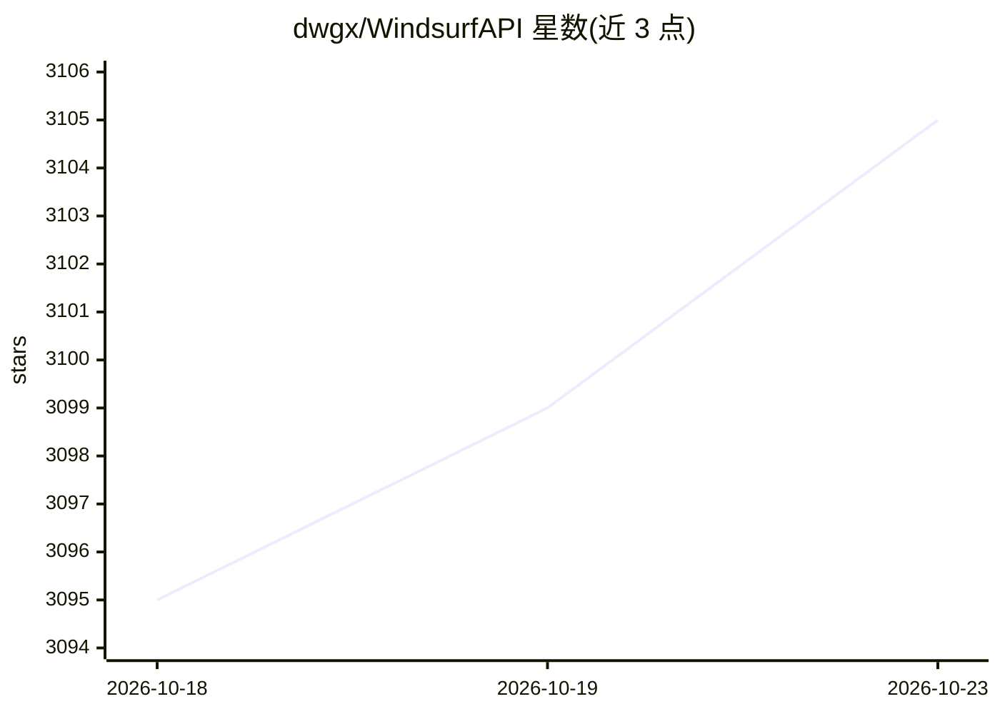

# dwgx/WindsurfAPI

⭐ 3,105 · JavaScript · MIT · 推送 2026-10-22 · [GitHub](https://github.com/dwgx/WindsurfAPI) · [官网](https://dwgx.github.io/WindsurfAPI/) · 个人维护 · 中文 README

**把 Windsurf/Devin 云端 100+ 模型转为 OpenAI/Anthropic/Gemini 兼容 API 的自托管反代**

纯 Node.js 自托管反向代理：把请求翻译为 Windsurf 内部 gRPC 协议，经本地 Language Server 调用 Windsurf 云端 100+ 模型（Claude、GPT、Gemini、DeepSeek、Kimi、GLM、SWE 等），对外同时暴露 OpenAI Chat/Completions/Responses、Anthropic Messages、Gemini 共四套兼容 API，供 Claude Code、Cline、Cursor 等客户端直连。维护账号池做轮询、速率限制与故障转移，附 Dashboard 管理与 OAuth/Token/批量三种加号方式。限制：空 API_KEY 默认 fail-closed；声明未 Star/Follow 者禁止商业使用；代码本体 MIT。

## 筛选速览

| 维度 | 判定 | 备注 |
|---|---|---|
| AI 角色 | `ai-ecosystem` | LLM/agent 周边工具 |
| 许可风险 | `permissive` | MIT |
| 部署形态 | `library` | 以包/库形式分发 |
| 模型依赖 | locked-api |  |
| 硬件要求 | — | 无带数字的原话,不猜 |
| 安装摩擦 | `low` | 无编译、无系统依赖或容器化 |
| 成熟度 | — | 结构信号不足 |

## 能力要点

- 四套兼容 API（OpenAI Chat/Completions/Responses、Anthropic Messages、Gemini）同时暴露于端口 3003
- 账号池自动轮询 + 速率限制 + 故障转移
- 零 npm 运行时依赖，纯 Node.js
- Responses API 带服务端会话状态（previous_response_id 续接、LRU 驱逐、租户配额）

## 适用场景

- 让 Claude Code / Cline / Cursor / Aider 通过兼容 API 使用 Windsurf 云端模型
- 自建中转服务统一管理多账号与调用密钥
- 用任一 OpenAI/Anthropic/Gemini 官方 SDK 直接调用上游模型

## 场景标签

`模型网关` · 领域:Agent 开发

## 证据(README 行号)

> L36: - `POST /v1/messages` — **Anthropic 兼容** Claude Code / Cline / Cursor 直接连
> L70: 2. 把请求翻译成 Windsurf 内部 gRPC 协议，通过本地 Language Server 发给 Windsurf 云
> L71: 3. 维护账号池，自动轮询 + 速率限制 + 故障转移

## 星数曲线

2026-10-18 3,095 → 2026-10-23 3,105（+10）

---
*卡片 v1 · prompt 1.4 · 生成 2026-10-21 · 置信度 mid · 依据 README sha `de9d4729a3b0` · [字段定义](../../DATASET.md)*
