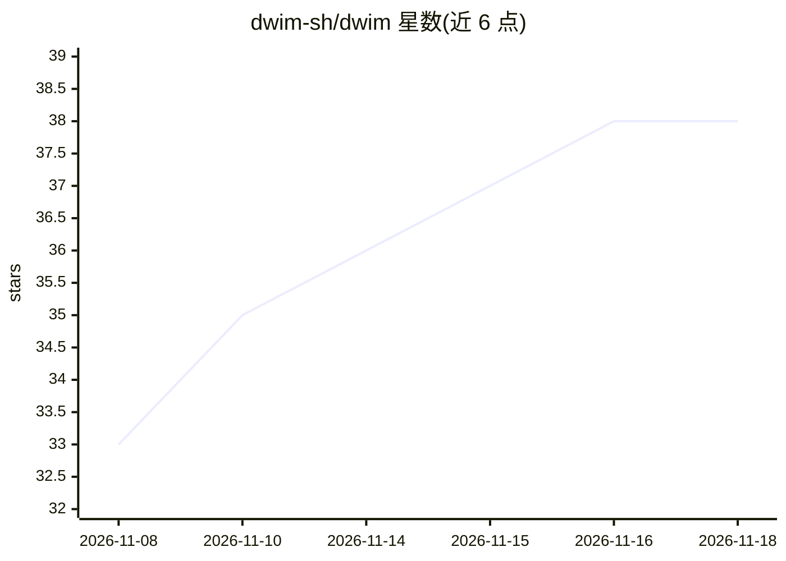

# dwim-sh/dwim

⭐ 38 · Rust · MIT · 推送 2026-11-17 · [GitHub](https://github.com/dwim-sh/dwim) · [官网](https://dwim.sh) · 组织维护

**本地优先的编码 agent：Rust 单程序内置模型与推理引擎**

用 Rust 实现的一体化编码 agent：agent、Qwen3.8-27B 模型（4-bit，16 GB）与推理引擎打包在单一程序中，本地运行无需 API key。内置本地推理服务器，多个会话共享权重、各自持有 GPU 上下文；macOS 用 Metal、Linux 用 Vulkan。可经 /provider 切换到 OpenRouter 上的 Qwen3.8 Max，或经 AI Gateway / Cerebras 运行。命令默认无确认执行，README 提示应在沙箱中运行且项目需已提交或备份；软件自称 experimental。还提供 /dwim plan 与 /dwim do 子 agent 工作流。

## 筛选速览

| 维度 | 判定 | 备注 |
|---|---|---|
| AI 角色 | `ai-native` | 本体是模型或模型工具 |
| 许可风险 | `permissive` | MIT |
| 部署形态 | `library` | 以包/库形式分发 |
| 模型依赖 | locked-api |  |
| 硬件要求 | — | 无带数字的原话,不猜 |
| 安装摩擦 | `medium` | 含编译或系统依赖之一 |
| 成熟度 | `idea` | |

## 能力要点

- agent、模型、推理引擎打包为单一 Rust 程序，本地运行无需 API key
- 内置本地推理服务器，多会话共享权重、各持独立上下文
- Metal（macOS）/ Vulkan（Linux）本地推理
- 可切换到 OpenRouter / AI Gateway / Cerebras 运行更大模型

## 适用场景

- 在本地用自然语言让 agent 读代码、跑命令、写代码
- 作为 Claude Code 或 Codex 的子 agent 承担写码任务
- 用 /dwim plan + /dwim do 按计划逐任务提交代码

## 场景标签

`编码 Agent` · 领域:编码与开发

## 证据(README 行号)

> L9: The agent, the model, and the engine that runs it, in one Rust program.
> L13: Model: Qwen3.8-27B
> L60: - **Fast local inference.** Metal on macOS, Vulkan on Linux.

## 星数曲线

2026-11-08 33 → 2026-11-18 38（+5）

---
*卡片 v1 · prompt 1.4 · 生成 2026-11-18 · 置信度 mid · 依据 README sha `5ef9a55af229` · [字段定义](../../DATASET.md)*
