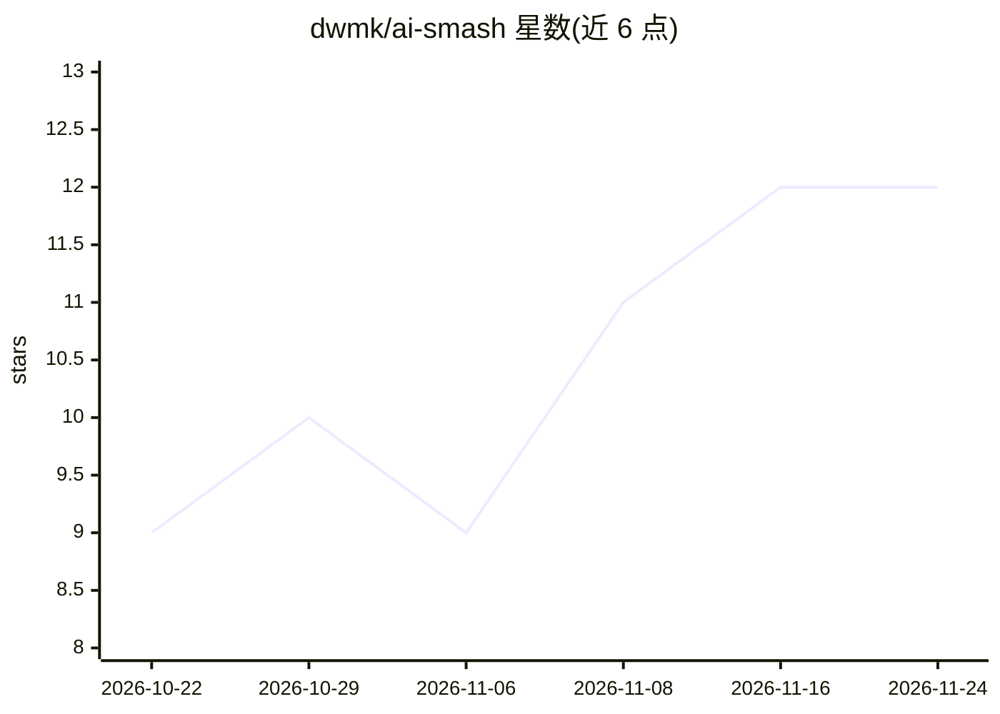

# dwmk/ai-smash

⭐ 12 · TypeScript · 推送 2026-10-20 · [GitHub](https://github.com/dwmk/ai-smash) · [官网](https://ai-smash.vercel.app) · 个人维护

**浏览器内运行小型 LLM 的 3D 虚拟角色对话平台**

全栈对话应用：可在浏览器内通过 Transformers.js 与 ONNX Runtime Web 运行 0.5B–2B 级小型语言模型，亦可连接本地/远程 Ollama 实例或多家云模型 API；前端以 Three.js 渲染 VRM 1.0 人形头像，提供语音合成、音素口型同步、表情驱动与物理动效。附带 AI 文本检测规避/humanizer 工具、自主工具调用（搜索/天气/维基）、MCP 协议端点与 GraphQL 第三方控制接口，支持可选的 NeonDB 账户同步。提供在线部署地址，未在 README 中给出本地安装步骤。

## 筛选速览

| 维度 | 判定 | 备注 |
|---|---|---|
| AI 角色 | `ai-native` | 本体是模型或模型工具 |
| 许可风险 | `none` | — |
| 部署形态 | `None` |  |
| 模型依赖 | local-ok | 支持本地模型 |
| 硬件要求 | — | 无带数字的原话,不猜 |
| 安装摩擦 | `low` | 无编译、无系统依赖或容器化 |
| 成熟度 | — | 结构信号不足 |

## 能力要点

- 浏览器内运行 SmolLM2/Qwen2.5-0.5B/Llama-3.2-1B 等 SLM，支持 WebGPU/WASM 加速与 FP16/Q4 量化
- VRM 人形 3D 头像：口型同步、表情、注视追踪与全身物理动效
- 支持连接云或本地 Ollama 端点，含健康检查与离线自动切换
- 提供 MCP 端点、GraphQL 接口与 Discord/Slack/n8n/Zapier webhook 集成

## 适用场景

- 在浏览器中与本地小型模型对话并获得 3D 角色语音交互
- 将 3D 虚拟角色接入 OBS 覆盖层或自定义客户端
- 通过 webhook 把对话接入自动化工作流

## 场景标签

`AI 助手` `语音合成` `聊天机器人` · 领域:对话与助手

## 证据(README 行号)

> L27: This platform is a full-stack conversational application uniting persona-driven dialogue with on-device client-side
> L33: - **In-Browser Edge SLM Neural Inference**: Execute lightweight Small Language Models (SmolLM2-135M, SmolLM2-360M, 

## 星数曲线

2026-10-22 9 → 2026-11-24 12（+3）

---
*卡片 v1 · prompt 1.4 · 生成 2026-11-18 · 置信度 high · 依据 README sha `3ed24530eb47` · [字段定义](../../DATASET.md)*
