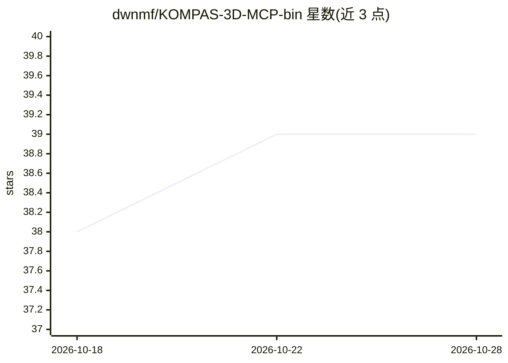

# dwnmf/KOMPAS-3D-MCP-bin

⭐ 39 · Python · 推送 2026-08-22 · [GitHub](https://github.com/dwnmf/KOMPAS-3D-MCP-bin) · 个人维护

**把 КОМПАС-3D 接入 MCP 客户端的 Windows 工具**

面向 КОМПАС-3D 用户的 Windows 可执行 MCP 服务器：让 Codex、Claude Desktop、Roo Code、Cline 等 MCP 客户端通过对话创建 2D 图纸、构建 3D 零件、检查模型、截图、导出 DXF 并辅助诊断。AI 不直接访问 COM API，命令经代理的安全层与严格 schema 传递；附带供 Codex 使用的 skill 目录。需要本机已安装 КОМПАС-3D，并通过官网获取 config.json 激活（含邀请码机制）。

## 筛选速览

| 维度 | 判定 | 备注 |
|---|---|---|
| AI 角色 | `ai-ecosystem` | LLM/agent 周边工具 |
| 许可风险 | `none` | — |
| 部署形态 | `desktop` | 安装包/桌面程序 |
| 模型依赖 | — | README 未给出锁定关系 |
| 硬件要求 | — | 无带数字的原话,不猜 |
| 安装摩擦 | `low` | 无编译、无系统依赖或容器化 |
| 成熟度 | — | 结构信号不足 |

## 能力要点

- 通过 MCP 让 AI 客户端操作 КОМПАС-3D 的 2D/3D 建模与制图
- AI 不直接访问 COM API，命令经安全代理层与严格 schema 传递
- 支持 CAD-as-Code（execute_tdcad_script）、几何脚本、scenario_runner 与截图/导出 DXF
- 附带 kompas-mcp-operator skill 提升 Codex 使用效果

## 适用场景

- 用自然语言让 AI 生成 3D 零件并截图验证
- 自动绘制 2D 图纸、标注尺寸并导出 DXF
- 让 AI 诊断模型构建树与几何问题

## 场景标签

 · 领域:CAD/工程软件自动化

## 证据(README 行号)

> L3: KOMPAS-3D MCP подключает КОМПАС-3D к AI-клиентам через MCP. Можно просить Codex, Claude, Roo Code, Cline и другие MC
> L120: - MCP работает через публичные инструменты и строгие схемы. AI не получает прямой сырой доступ к COM API — команды

## 星数曲线

2026-10-18 38 → 2026-10-28 39（+1）

---
*卡片 v1 · prompt 1.4 · 生成 2026-10-25 · 置信度 high · 依据 README sha `6734208adcf3` · [字段定义](../../DATASET.md)*
