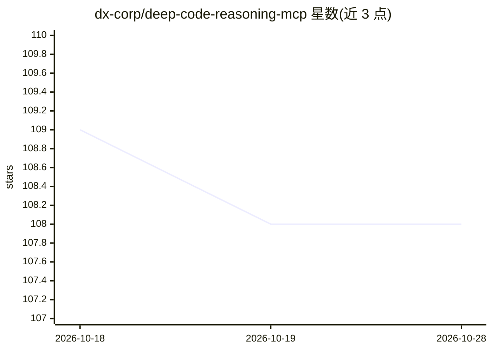

# dx-corp/deep-code-reasoning-mcp

⭐ 108 · TypeScript · MIT · 推送 2026-10-21 · [GitHub](https://github.com/dx-corp/deep-code-reasoning-mcp) · 个人维护

**MCP 服务器：让 Claude Code 将复杂代码分析移交给 Gemini 处理**

一个 Node.js 实现的 Model Context Protocol 服务器，为 Claude Code/Cursor 等客户端提供接入 Google Gemini 2.5 Pro 的代码分析工具：在 Claude 处理本地上下文与增量修改的同时，将超大日志/追踪分析、跨服务影响分析、性能瓶颈识别与假设检验等任务移交给具备 1M token 上下文的 Gemini。提供 Claude 与 Gemini 的多轮对话式分析工具，以及 escalate_analysis、trace_execution_path 等工具。需 Node.js 18+ 与 Gemini API key，代码会发送至 Google API。

## 筛选速览

| 维度 | 判定 | 备注 |
|---|---|---|
| AI 角色 | `ai-ecosystem` | LLM/agent 周边工具 |
| 许可风险 | `permissive` | MIT |
| 部署形态 | `library` | 以包/库形式分发 |
| 模型依赖 | — | README 未给出锁定关系 |
| 硬件要求 | — | 无带数字的原话,不猜 |
| 安装摩擦 | `low` | 无编译、无系统依赖或容器化 |
| 成熟度 | — | 结构信号不足 |

## 能力要点

- 基于 Gemini 2.5 Pro 1M token 上下文的长追踪与大规模日志分析
- Claude 与 Gemini 之间的多轮对话式分析工具（start/continue/finalize_conversation）
- 跨服务影响分析、性能瓶颈识别与证据驱动的假设检验工具
- 以 MCP 服务器形式接入 Claude Desktop / Claude Code / Cursor

## 适用场景

- 排查跨多个微服务、日志达 GB 级的分布式系统故障
- 在性能回退时关联部署时间线与性能指标定位提交
- 以多模型分工方式调试与验证大量假设场景

## 场景标签

`编码 Agent` · 领域:编码与开发

## 证据(README 行号)

> L5: Node.js Version
> L7: An MCP server that pairs Claude Code with Google's Gemini AI for complementary code analysis. This server enables a 
> L35: - **@google/generative-ai**: Google's official SDK for Gemini API integration

## 星数曲线

2026-10-18 109 → 2026-10-28 108（-1）

---
*卡片 v1 · prompt 1.4 · 生成 2026-10-23 · 置信度 high · 依据 README sha `54fe05895b84` · [字段定义](../../DATASET.md)*
