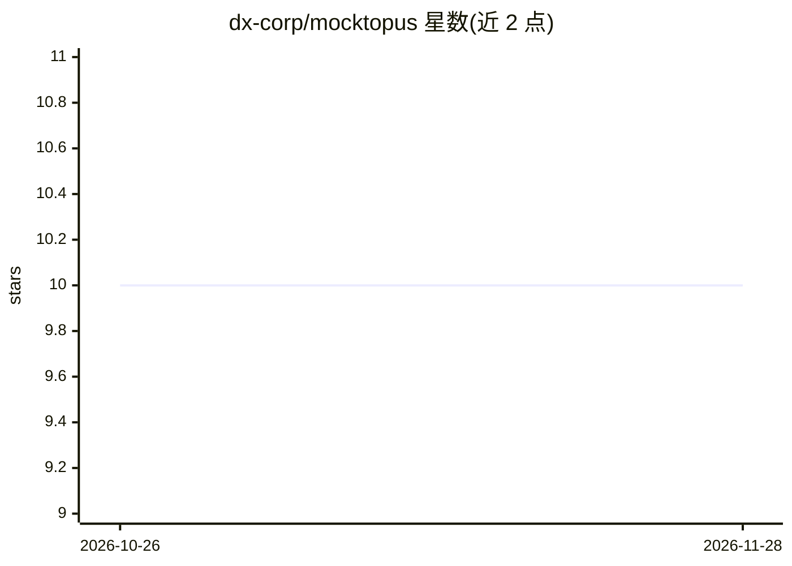

# dx-corp/mocktopus

⭐ 10 · Python · MIT · 推送 2026-10-20 · [GitHub](https://github.com/dx-corp/mocktopus) · [官网](https://github.com/evalops/mocktopus) · 组织维护

**面向 LLM 应用的确定性 mock API 服务器**

Mocktopus 是面向 LLM 应用的确定性测试工具，定位为 OpenAI/Anthropic API 的直接替换（drop-in replacement），以 mock 服务器形式返回确定性结果用于测试与 CI 场景。当前 README 仅含仓库迁移说明：规范源码已迁移至 evalops/mono 仓库的 labs/mocktopus 目录，本目录由 evalops/mono#6596 的特定提交导入，且声明不再接受新产品改动，需向 evalops/mono 提交 PR。安装与运行细节在本 README 中不可见。

## 筛选速览

| 维度 | 判定 | 备注 |
|---|---|---|
| AI 角色 | `ai-ecosystem` | LLM/agent 周边工具 |
| 许可风险 | `permissive` | MIT |
| 部署形态 | `None` |  |
| 模型依赖 | — | README 未给出锁定关系 |
| 硬件要求 | — | 无带数字的原话,不猜 |
| 安装摩擦 | `low` | 无编译、无系统依赖或容器化 |
| 成熟度 | — | 结构信号不足 |

## 能力要点

- 定位为 OpenAI/Anthropic API 的 drop-in replacement
- 为 LLM 应用测试提供确定性 mock 响应
- 源码已迁移至 evalops/mono 的 labs/mocktopus 目录

## 适用场景

- 在 CI 中对调用 LLM API 的应用做确定性测试
- 以替换 OpenAI/Anthropic 端点的方式集成到现有测试流程

## 场景标签

`模型评测` · 领域:评测与运维

## 证据(README 行号)

> L1: # Mocktopus
> L3: Canonical source for this repository now lives in `evalops/mono` at `labs/mocktopus`.

## 星数曲线

2026-10-26 10 → 2026-11-28 10（+0）

---
*卡片 v1 · prompt 1.4 · 生成 2026-11-19 · 置信度 low · 依据 README sha `5e13d75a0ffd` · [字段定义](../../DATASET.md)*
