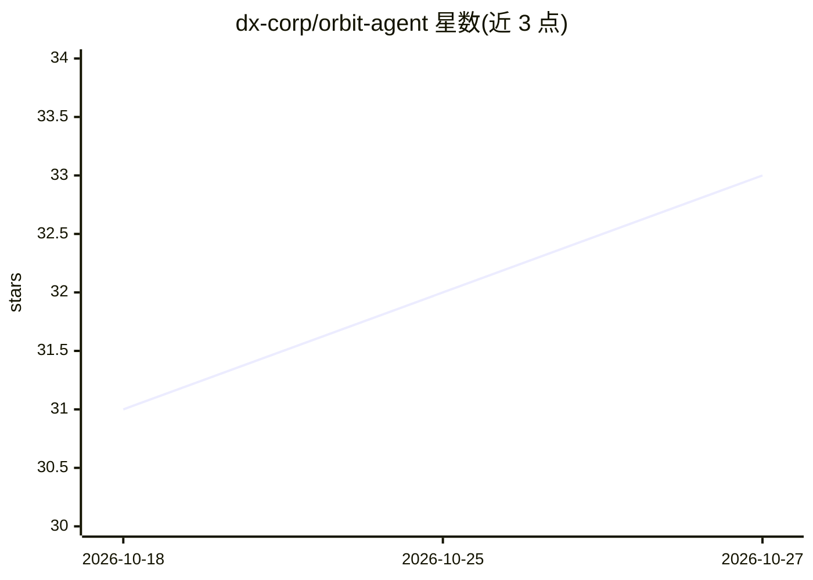

# dx-corp/orbit-agent

⭐ 33 · Python · MIT · 推送 2026-10-26 · [GitHub](https://github.com/dx-corp/orbit-agent) · 组织维护

**可 CLI/SMS 调用的 YC 风格创业顾问 AI 应用**

基于 DSPy 构建的创业建议应用，面向创始人：通过 CLI 或 SMS 获取情境化的 YC 风格建议（default-alive、48h 聚焦计划），内置稀释、资金跑道、EV、留存与漏斗等财务计算工具。机制上支持 Best-of-N 多稿生成加 critic 重排、跨会话对话记忆（SQLite 存储）、带 rubric 的 persona 评测与 CSV/MD 报告，并定义了版本化的评测产物一致性契约。模型后端可选 OpenAI/Anthropic 或本地 Ollama。README 明示建议可能出错，决策责任在使用者。

## 筛选速览

| 维度 | 判定 | 备注 |
|---|---|---|
| AI 角色 | `ai-native` | 本体是模型或模型工具 |
| 许可风险 | `permissive` | MIT |
| 部署形态 | `self-host` | docker 或自建部署 |
| 模型依赖 | local-ok | 支持本地模型 |
| 硬件要求 | — | 无带数字的原话,不猜 |
| 安装摩擦 | `low` | 无编译、无系统依赖或容器化 |
| 成熟度 | — | 结构信号不足 |

## 能力要点

- DSPy 编排的建议生成，Best-of-N + critic 重排
- 稀释/跑道/EV/留存/漏斗等财务计算工具
- CLI 与 SMS 双通道，含速率限制与安全 webhook
- 带 rubric 的 persona 评测与版本化评测产物契约

## 适用场景

- 创始人随时向 AI 顾问咨询融资稀释与跑道等决策
- 生成 48 小时聚焦执行计划
- 通过短信获取即时建议

## 场景标签

`AI 助手` · 领域:对话与助手

## 证据(README 行号)

> L3: A brutally honest "high‑orbit" startup advisor you can text or run from the CLI.
> L8: - **🎯 Smart Advisor**: Context-aware advice that adapts to your specific situation.
> L14: - **🧠 Best-of-N + Rerank**: Generate multiple drafts and pick the best via a critic.

## 星数曲线

2026-10-18 31 → 2026-10-27 33（+2）

---
*卡片 v1 · prompt 1.4 · 生成 2026-10-26 · 置信度 high · 依据 README sha `8c7b3eb01a79` · [字段定义](../../DATASET.md)*
