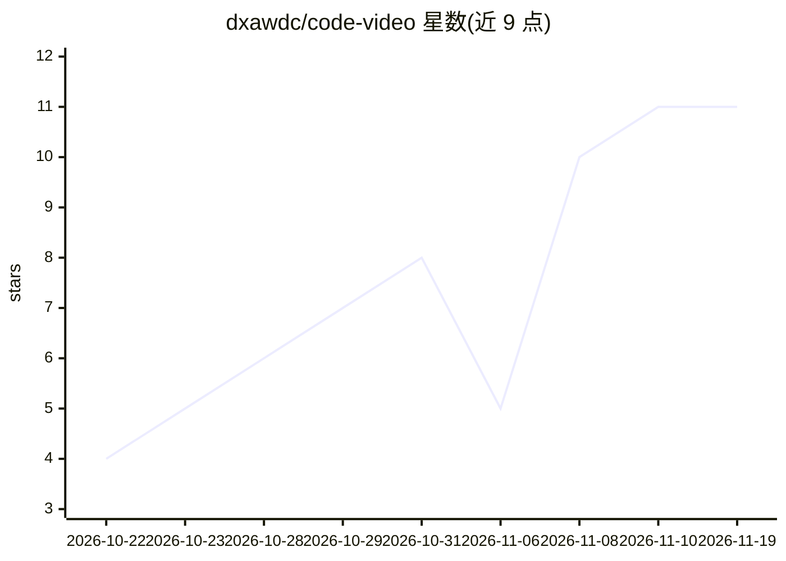

# dxawdc/code-video

⭐ 11 · JavaScript · NOASSERTION · 推送 2026-10-23 · [GitHub](https://github.com/dxawdc/code-video) · [官网](https://github.com/dxawdc/code-video) · 个人维护 · 中文 README

**给 AI Agent 的代码做视频技能与 film CLI，一键出片**

一个开放标准的 Agent Skill（SKILL.md + references 流程与审美规范）配合 `film` 命令行，让接入的大模型以写代码的方式产出视频：九种技术栈渲染画面、代码合成配乐音效、edge-tts 旁白与自动字幕、抽帧联系表供 AI 逐帧审片、verify 校验后交付母版/分享版/封面/字幕。安装器把技能复制到 Claude Code、Codex、WorkBuddy 等工具的技能目录。依赖 Node.js 18+、ffmpeg、Chrome/Edge；Remotion 栈对一定规模公司商用需向第三方购买授权。

## 筛选速览

| 维度 | 判定 | 备注 |
|---|---|---|
| AI 角色 | `ai-native` | 本体是模型或模型工具 |
| 许可风险 | `permissive` | NOASSERTION |
| 部署形态 | `None` |  |
| 模型依赖 | — | README 未给出锁定关系 |
| 硬件要求 | — | 无带数字的原话,不猜 |
| 安装摩擦 | `medium` | 含编译或系统依赖之一 |
| 成熟度 | — | 结构信号不足 |

## 能力要点

- 九种渲染技术栈可混用（Canvas/GLSL/Three.js/p5.brush/DOM+GSAP/Remotion/Manim/Blender 等）
- 画面为时间 t 的纯函数，支持跳帧预览与逐帧确定性渲染
- AI 抽帧审片闭环：stills 联系表逐张检查 + lint + verify 校验报告
- 代码合成配乐（−15 LUFS 自动响度校正）与 edge-tts 旁白、自动字幕

## 适用场景

- 让 Claude Code 直接生成一条可发布的科普短片
- 把 CSV 数据做成数据故事视频用于内容运营
- 批量产出竖屏短视频适配抖音/Reels 等平台
- 数学/算法教学动画（Manim 栈）配旁白字幕

## 场景标签

`视频生成` · 领域:内容生成

## 证据(README 行号)

> L5: 一个开放标准的 Agent Skill + `film` 命令行：九种技术栈、代码合成配乐与旁白、逐帧审片、一键出片。
> L27: - **方法**：`SKILL.md` + `references/` 详细规定了从需求、分镜、时间表、画面、声音到审片、交付的每一步，以及配色、字号、动效、构图、字幕的审美规范——AI 照着做，出来的片子统一、克制、好看，而不是
> L112: code-video 是“文档 + 命令行”，**与模型无关**：任何能读文件、能执行终端命令的 Agent 都能用，背后接 Claude、GPT、Gemini、DeepSeek、Qwen、GLM、Kimi 等模型都可以。写代码

## 星数曲线

2026-10-22 4 → 2026-11-19 11（+7）

---
*卡片 v1 · prompt 1.4 · 生成 2026-11-18 · 置信度 high · 依据 README sha `89bc3830622d` · [字段定义](../../DATASET.md)*
