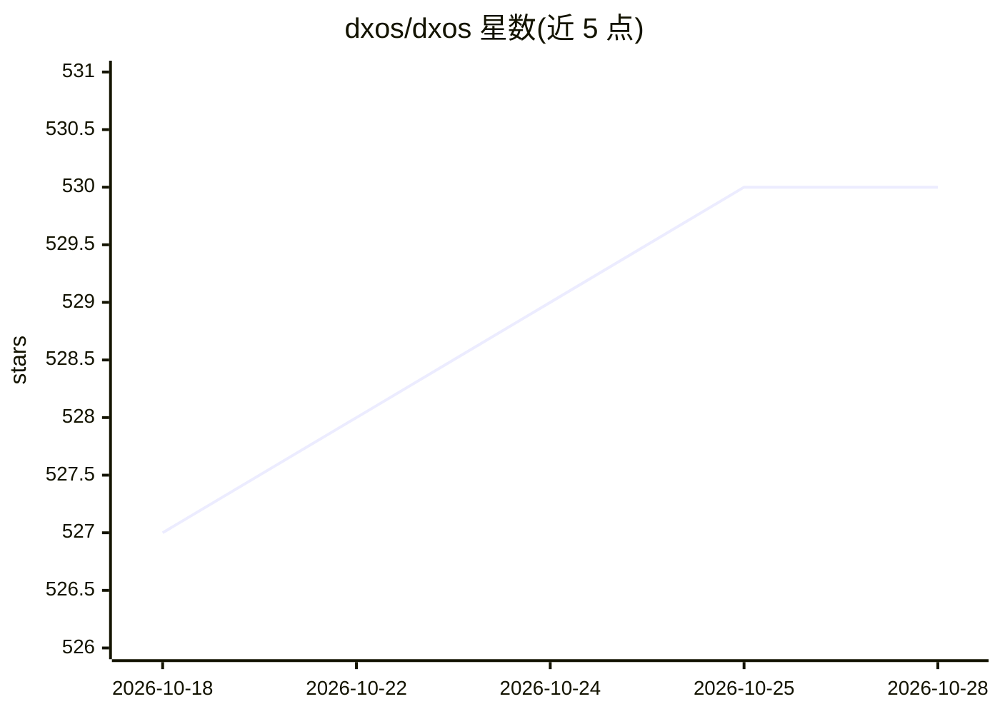

# dxos/dxos

⭐ 530 · TypeScript · NOASSERTION · 推送 2026-10-27 · [GitHub](https://github.com/dxos/dxos) · [官网](https://dxos.org) · 组织维护

**构建完全去中心化应用的平台与 SDK，附 Composer IDE**

DXOS（Decentralized Operating System）是一个用于构建完全去中心化应用的 TypeScript 平台，提供协议实现、SDK 与工具链，并基于 CRDT/P2P 技术标签。仓库同时承载 Composer——一个可扩展 IDE，支持实时与异步协作，帮助团队组织知识并创建可定制的 AI 驱动工作流。AI 能力存在于 Composer 工作区中，平台本体（去中心化数据与协作）不依赖 AI。项目以 FSL-1.1-Apache-2.0 许可发布，通过 Discord 与文档提供社区支持。

## 筛选速览

| 维度 | 判定 | 备注 |
|---|---|---|
| AI 角色 | `ai-enhanced` | 去掉 AI 部分产品仍成立 |
| 许可风险 | `none` | NOASSERTION |
| 部署形态 | `None` |  |
| 模型依赖 | — | README 未给出锁定关系 |
| 硬件要求 | — | 无带数字的原话,不猜 |
| 安装摩擦 | `low` | 无编译、无系统依赖或容器化 |
| 成熟度 | — | 结构信号不足 |

## 能力要点

- TypeScript 实现的 DXOS 协议、SDK 与工具链
- Composer：支持实时/异步协作的可扩展模块化 IDE
- 可在 Composer 中创建可定制的 AI 驱动工作流

## 适用场景

- 用 TypeScript SDK 构建去中心化应用
- 团队在 Composer 中实时协作并组织知识
- 搭建带 AI 工作流的可组合工作区

## 场景标签

 · 领域:去中心化软件/开发平台

## 证据(README 行号)

> L14: DXOS is the Decentralized Operating System — a platform for building fully decentralized applications.
> L16: DXOS is also the home of Composer — an extensible IDE, built for both real time and async collaboration. Composer h

## 星数曲线

2026-10-18 527 → 2026-10-28 530（+3）

---
*卡片 v1 · prompt 1.4 · 生成 2026-10-21 · 置信度 mid · 依据 README sha `0933ef223676` · [字段定义](../../DATASET.md)*
