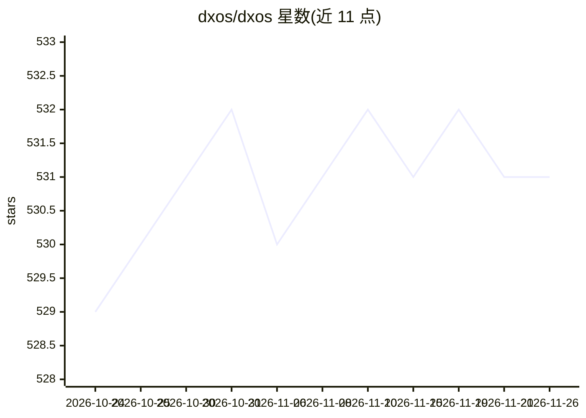

# dxos/dxos

⭐ 531 · TypeScript · NOASSERTION · 推送 2026-11-25 · [GitHub](https://github.com/dxos/dxos) · [官网](https://dxos.org) · 组织维护

**去中心化应用开发平台 SDK 与协作工作区 Composer**

DXOS 提供去中心化协议的 TypeScript 实现，包括 SDK、工具链与 Composer。Composer 是支持实时与异步协作的可扩展 IDE，团队用它构建与组织知识、创建可定制的 AI 驱动工作流，以模块化可组合工作区形式提供。项目以 npm 发布、提供 SDK 文档与 API 参考，社区通过 Discord 与贡献指南参与；许可为 FSL-1.1-Apache-2.0。

## 筛选速览

| 维度 | 判定 | 备注 |
|---|---|---|
| AI 角色 | `ai-enhanced` | 去掉 AI 部分产品仍成立 |
| 许可风险 | `none` | NOASSERTION |
| 部署形态 | `None` |  |
| 模型依赖 | — | README 未给出锁定关系 |
| 硬件要求 | — | 无带数字的原话,不猜 |
| 安装摩擦 | `low` | 无编译、无系统依赖或容器化 |
| 成熟度 | — | 结构信号不足 |

## 能力要点

- 去中心化协议的 TypeScript 实现与 SDK、工具链
- Composer：支持实时与异步协作的可扩展 IDE
- 可定制的 AI 驱动工作流，模块化可组合工作区
- FSL-1.1-Apache-2.0 双许可

## 适用场景

- 构建去中心化 P2P 应用
- 团队实时协作编辑与知识组织
- 搭建 AI 驱动的团队工作流

## 场景标签

`工作流自动化` `知识库管理` · 领域:效率与自动化

## 证据(README 行号)

> L14: DXOS is the Decentralized Operating System — a platform for building fully decentralized applications.
> L16: DXOS is also the home of Composer — an extensible IDE, built for both real time and async collaboration. Composer h

## 星数曲线

2026-10-24 529 → 2026-11-26 531（+2）

---
*卡片 v1 · prompt 1.4 · 生成 2026-11-25 · 置信度 mid · 依据 README sha `3972b834fbf0` · [字段定义](../../DATASET.md)*
