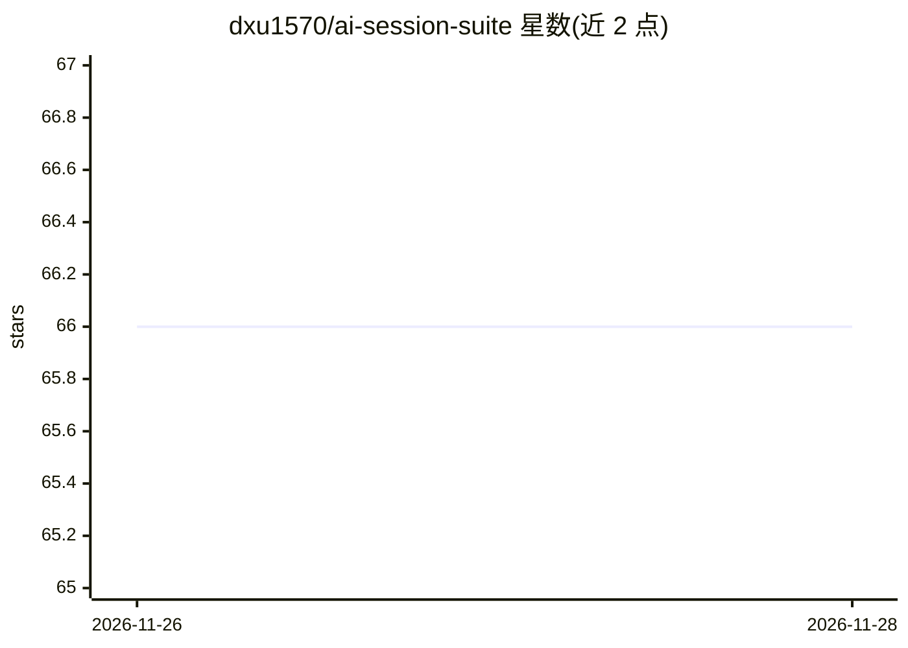

# dxu1570/ai-session-suite

⭐ 66 · C++ · MIT · 推送 2026-11-25 · [GitHub](https://github.com/dxu1570/ai-session-suite) · 个人维护

**面向 AI 服务的会话轮换单二进制工具（Windows x64）**

以单个预构建二进制形式发布的会话轮转工具套件，面向 AI 服务的会话管理，运行于 64 位 Windows 10/11。参数集中存放于 config/settings.json，支持运行中热重载、原子化 JSON 状态与崩溃回滚、默认静默的 stderr 遥测；README 称无外部依赖。提供免编译的便携包（zip 加压密码 2026 后运行安装器），也可经 git clone 与 cmake 从源码构建。

## 筛选速览

| 维度 | 判定 | 备注 |
|---|---|---|
| AI 角色 | `ai-ecosystem` | LLM/agent 周边工具 |
| 许可风险 | `permissive` | MIT |
| 部署形态 | `desktop` | 安装包/桌面程序 |
| 模型依赖 | — | README 未给出锁定关系 |
| 硬件要求 | — | 无带数字的原话,不猜 |
| 安装摩擦 | `medium` | 含编译或系统依赖之一 |
| 成熟度 | — | 结构信号不足 |

## 能力要点

- 单二进制便携发布，解压后直接运行
- config/settings.json 全参数化，支持不重启热重载
- 原子 JSON 状态与崩溃安全回滚
- 默认静默的 stderr 遥测，--verbose 可开

## 适用场景

- 在不改动代码的前提下调整 AI 服务的会话配置
- 以低开销后台工具形式管理多个 AI 服务会话

## 场景标签

`模型网关` · 领域:Agent 开发

## 证据(README 行号)

> L3:  AI Session Suite — AI Session Suite — Session rotation suite for ALL AI services — one binary. (Portable x64 Build,
> L18: **AI Session Suite — Session rotation suite for ALL AI services — one binary** (`ai-session-suite`) is a dedicated,

## 星数曲线

2026-11-26 66 → 2026-11-28 66（+0）

---
*卡片 v1 · prompt 1.4 · 生成 2026-11-26 · 置信度 low · 依据 README sha `e082a092ba2a` · [字段定义](../../DATASET.md)*
