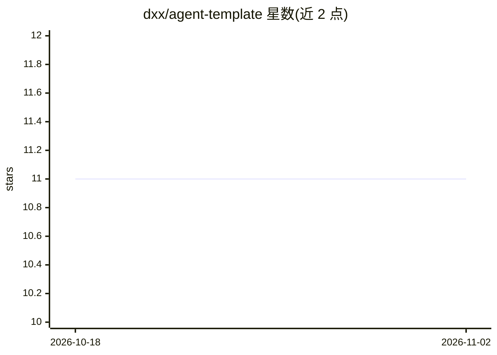

# dxx/agent-template

⭐ 11 · Python · MIT · 推送 2026-11-01 · [GitHub](https://github.com/dxx/agent-template) · 个人维护 · 中文 README

**基于 LangChain/LangGraph 的 AI Agent 服务工程模板**

面向 AI Agent 服务开发的项目模板，基于 FastAPI + LangChain + LangGraph 构建，内置子代理协作、路由代理、Skills 技能系统、人工审批（human-in-the-loop）、多模态、MCP 工具接入与消息管理能力，提供流式对话 API。LLM 通过 OpenAI 兼容 API 接入，用 uv 管理依赖，支持 Docker 部署，附带 HTTP 测试文件与配套前端项目 agent-template-ui。目标是沉淀常见 Agent 架构与目录规范，减少重复搭建。

## 筛选速览

| 维度 | 判定 | 备注 |
|---|---|---|
| AI 角色 | `ai-ecosystem` | LLM/agent 周边工具 |
| 许可风险 | `permissive` | MIT |
| 部署形态 | `self-host` | docker 或自建部署 |
| 模型依赖 | — | README 未给出锁定关系 |
| 硬件要求 | — | 无带数字的原话,不猜 |
| 安装摩擦 | `low` | 无编译、无系统依赖或容器化 |
| 成熟度 | — | 结构信号不足 |

## 能力要点

- 内置子代理协作、路由代理与人工审批流程
- Skills 技能系统与 MCP 工具接入
- FastAPI 流式对话 API，附带 7 组 HTTP 测试文件
- 提供 Docker 部署方式与配套 Web 前端项目

## 适用场景

- 作为 Agent 服务的项目起点，避免从零搭建架构
- 快速获得带人工审批与子代理协作的对话服务
- 在统一工程结构下配合 AI 编程生成代码

## 场景标签

`Agent 框架` `多智能体` · 领域:Agent 开发

## 证据(README 行号)

> L6: 专用于 AI Agent 服务的项目模版，基于 LangChain + LangGraph 构建，支持多子代理协作、路由代理协作和人工审批流程。
> L11: 这个项目正是为了解决这些问题而设计的。它不是一个简单的 Demo，而是一个面向 AI Agent 服务开发的工程模板，基于 FastAPI、LangChain 和 LangGraph 构建，内置了子代理协作、路由代理、Skills

## 星数曲线

2026-10-18 11 → 2026-11-02 11（+0）

---
*卡片 v1 · prompt 1.4 · 生成 2026-11-02 · 置信度 high · 依据 README sha `be5a0f9f6d64` · [字段定义](../../DATASET.md)*
