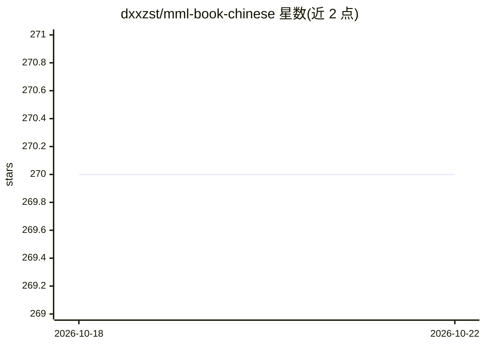

# dxxzst/mml-book-chinese

⭐ 270 · MIT · 推送 2026-09-30 · [GitHub](https://github.com/dxxzst/mml-book-chinese) · 个人维护 · 中文 README

**《机器学习中的数学》中文学术教材翻译项目**

对英文教材《Mathematics For Machine Learning》进行中文翻译的开源图书项目，翻译已完成并开放校验协作。内容为机器学习所需数学基础（线性代数、微积分、概率等教材章节，目录见 README 后续部分）。阅读方式：将项目 clone 到本地后用 Visual Studio Code 配合 Markdown Preview Enhanced 插件查看，以正确显示公式；README 另提供英文原版入口与常见问题说明。面向机器学习学习者的中文读者群体。

## 筛选速览

| 维度 | 判定 | 备注 |
|---|---|---|
| AI 角色 | `ai-knowledge` | 知识聚合/清单类 |
| 许可风险 | `permissive` | MIT |
| 部署形态 | `None` |  |
| 模型依赖 | — | README 未给出锁定关系 |
| 硬件要求 | — | 无带数字的原话,不猜 |
| 安装摩擦 | `low` | 无编译、无系统依赖或容器化 |
| 成熟度 | — | 结构信号不足 |

## 能力要点

- 《Mathematics For Machine Learning》全书中文翻译已完成
- 通过 VS Code 与 Markdown Preview Enhanced 插件正确显示公式
- 开放社区校验与协作改进

## 适用场景

- 用中文学习机器学习数学基础教材
- 配合英文原版对照阅读
- 参与翻译校验与纠错

## 场景标签

 · 领域:机器学习/数学教材

## 证据(README 行号)

> L1: # 机器学习中的数学 中文版
> L3: 英文原版请移步 《Mathematics For Machine Learning》

## 星数曲线

2026-10-18 270 → 2026-10-22 270（+0）

---
*卡片 v1 · prompt 1.4 · 生成 2026-10-22 · 置信度 high · 依据 README sha `8819fba4a856` · [字段定义](../../DATASET.md)*
