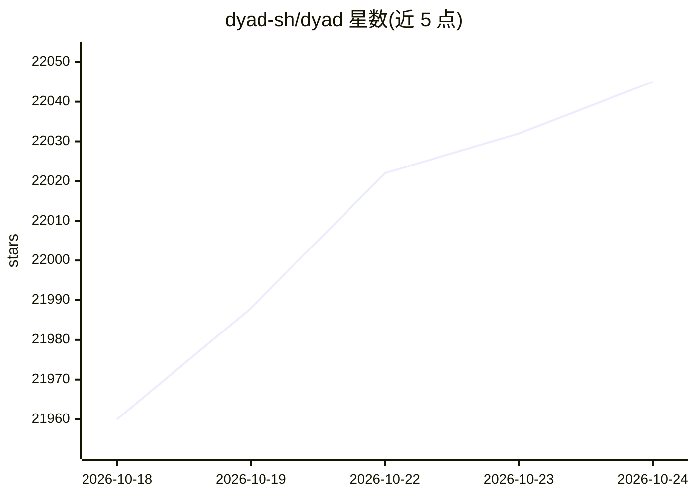

# dyad-sh/dyad

⭐ 22,045 · TypeScript · NOASSERTION · 推送 2026-10-22 · [GitHub](https://github.com/dyad-sh/dyad) · [官网](https://dyad.sh) · 组织维护

**本地运行的开源 AI 应用构建器，面向进阶用户**

Dyad 是一个在本地机器上运行的开源 AI 应用构建器，定位为 Lovable、v0、Bolt 的替代品。采用自带 API 密钥（bring your own keys）模式，用户使用自己的 AI API 密钥，无需注册即可下载使用，支持 Mac 与 Windows 双平台。代码采用 Apache 2.0 许可证，仓库中 `src/pro` 目录之外的代码开源。项目维护 Reddit 社区（r/dyadbuilders）供用户分享项目与交流。

## 筛选速览

| 维度 | 判定 | 备注 |
|---|---|---|
| AI 角色 | `ai-native` | 本体是模型或模型工具 |
| 许可风险 | `none` | NOASSERTION |
| 部署形态 | `None` |  |
| 模型依赖 | — | README 未给出锁定关系 |
| 硬件要求 | — | 无带数字的原话,不猜 |
| 安装摩擦 | `low` | 无编译、无系统依赖或容器化 |
| 成熟度 | — | 结构信号不足 |

## 动量与使用信号

- 维护:`active` — 距上次 push 1.5 天,年发版 98,35 位贡献者
- 涨星:近 1 天 **+18**(自 20261016 起算)
- 下载:GitHub Release 附件 累计 2,828,231(100 个 release)
- 平台:WINDOWS · 协议:—

## 能力要点

- 本地运行，自带 API 密钥，无供应商锁定
- 支持 Mac 与 Windows 跨平台
- 无需注册，下载即用
- 代码以 Apache 2.0 许可开源（src/pro 除外）

## 适用场景

- 在本地机器上用 AI 生成应用
- 使用自己的 AI API 密钥构建应用
- 参与 AI 应用构建社区交流项目

## 场景标签

`编码 Agent` · 领域:编码与开发

## 证据(README 行号)

> L3: Dyad is a local, open-source AI app builder. It's fast, private, and fully under your control — like Lovable, v0, or
> L11: - ⚡️ **Local**: Fast, private and no lock-in.
> L12: - 🛠 **Bring your own keys**: Use your own AI API keys — no vendor lock-in.

## 星数曲线

2026-10-18 21,960 → 2026-10-24 22,045（+85）

---
*卡片 v1 · prompt 1.4 · 生成 2026-10-18 · 置信度 high · 依据 README sha `82ce94d93cda` · [字段定义](../../DATASET.md)*
