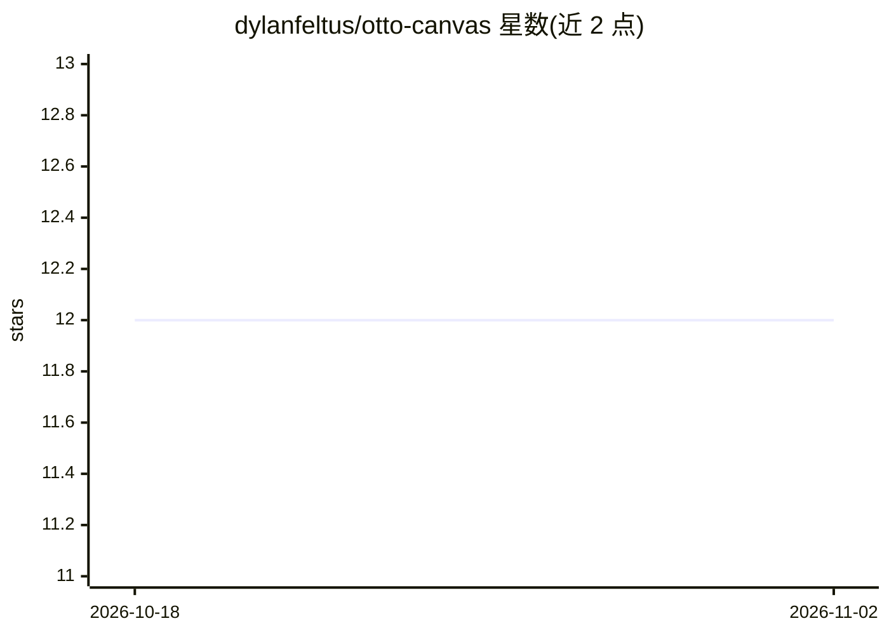

# dylanfeltus/otto-canvas

⭐ 12 · TypeScript · MIT · 推送 2026-02-18 · [GitHub](https://github.com/dylanfeltus/otto-canvas) · [官网](https://canvas.otto.design) · 个人维护

**开源 AI 设计工具：描述需求生成 HTML/CSS 设计稿**

基于 Next.js 15 构建的开源 AI 设计工具：用户在无限画布上用自然语言描述设计，获得多个 HTML/CSS 设计变体。多模型流水线由 Claude 负责布局生成与视觉 QA，Gemini 生成图像；采用顺序批判循环让每个新概念基于前一版改进。支持设计预设（UI/UX、营销网站、品牌广告）、点击评论、导出到 Figma/Tailwind/React。用户需自带 Anthropic 与 Gemini API key。通过 git clone 源码本地运行，也有在线版。

## 筛选速览

| 维度 | 判定 | 备注 |
|---|---|---|
| AI 角色 | `ai-native` | 本体是模型或模型工具 |
| 许可风险 | `permissive` | MIT |
| 部署形态 | `None` |  |
| 模型依赖 | locked-api |  |
| 硬件要求 | — | 无带数字的原话,不猜 |
| 安装摩擦 | `low` | 无编译、无系统依赖或容器化 |
| 成熟度 | — | 结构信号不足 |

## 能力要点

- 描述需求生成多个 HTML/CSS 设计变体
- Claude 布局 + Gemini 图像 + Claude 视觉 QA 的多模型流水线
- 顺序批判循环：每版基于前版 AI 评审改进
- 导出到 Figma、Tailwind CSS 或 React 组件

## 适用场景

- 快速生成按钮、卡片、导航等 UI 组件设计
- 生成落地页、仪表盘等整页设计变体
- 制作社交媒体广告与品牌素材

## 场景标签

`图像生成` `代码生成` · 领域:编码与开发

## 证据(README 行号)

> L5: An open-source AI design tool by Otto. Describe what you want, get multiple design variations on an infinite canvas,
> L14: - ✨ **AI Design Generation** — Describe a design, get multiple polished HTML/CSS variations with smart sizing
> L16: - 🎭 **Multi-Model Pipeline** — Claude handles layout, Gemini generates images, then Claude does a visual QA pass. T

## 星数曲线

2026-10-18 12 → 2026-11-02 12（+0）

---
*卡片 v1 · prompt 1.4 · 生成 2026-11-01 · 置信度 high · 依据 README sha `b0bb598a1856` · [字段定义](../../DATASET.md)*
