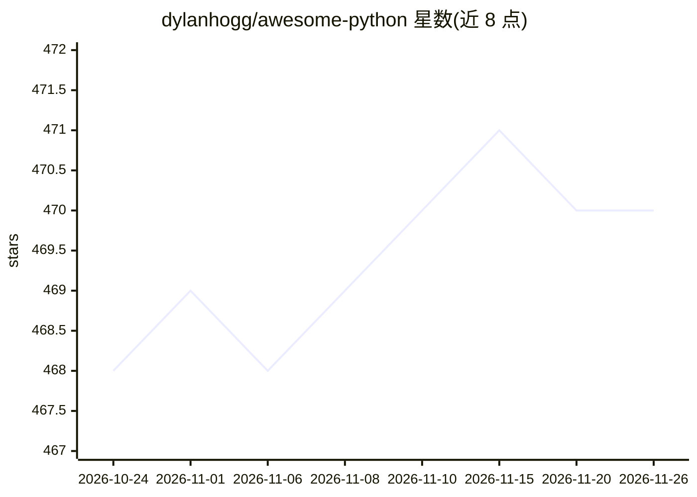

# dylanhogg/awesome-python

⭐ 470 · MIT · 推送 2026-11-04 · [GitHub](https://github.com/dylanhogg/awesome-python) · [官网](https://www.awesomepython.org) · 个人维护

**按类别组织的 Python 库与框架精选清单**

以 awesome-list 形式维护的 Python 生态编目：按 30+ 类别（Agentic AI、LLMs、机器学习、数据、Web、测试等）收录 1,515 个仓库，每条附简介与链接，定期更新，另有可交互网站 www.awesomepython.org。面向需要查找 Python 库的开发者与数据科学从业者，本身不提供功能，仅提供分类导航；条目按星标数排序展示。

## 筛选速览

| 维度 | 判定 | 备注 |
|---|---|---|
| AI 角色 | `ai-knowledge` | 知识聚合/清单类 |
| 许可风险 | `permissive` | MIT |
| 部署形态 | `library` | 以包/库形式分发 |
| 模型依赖 | — | README 未给出锁定关系 |
| 硬件要求 | — | 无带数字的原话,不猜 |
| 安装摩擦 | `low` | 无编译、无系统依赖或容器化 |
| 成熟度 | — | 结构信号不足 |

## 能力要点

- 按 30+ 类别组织 1,515 个 Python 仓库
- 覆盖 Agentic AI、LLM/ChatGPT、机器学习各细分、数据、Web 等领域
- 提供可交互版本网站 awesomepython.org
- 定期更新并单独列出最新创建的仓库

## 适用场景

- 为项目寻找合适的 Python 库或框架
- 了解 AI agent、LLM 等领域 Python 生态的最新仓库
- 按类别浏览数据科学和机器学习工具

## 场景标签

`精选清单` · 领域:学习与行业

## 证据(README 行号)

> L5: Hand-picked awesome Python libraries and frameworks, organised by category 🐍
> L11: ## Categories
> L26: - LLMs and ChatGPT - Large language model and GPT libraries and frameworks: auto-gpt, agents, QnA, chain-of-thought

## 星数曲线

2026-10-24 468 → 2026-11-26 470（+2）

---
*卡片 v1 · prompt 1.4 · 生成 2026-11-25 · 置信度 mid · 依据 README sha `f69d2ff95345` · [字段定义](../../DATASET.md)*
