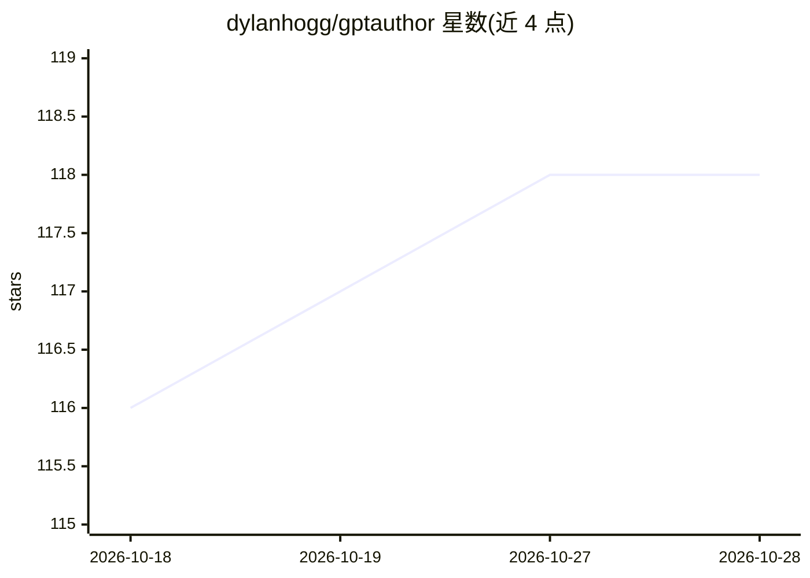

# dylanhogg/gptauthor

⭐ 118 · Python · MIT · 推送 2026-08-15 · [GitHub](https://github.com/dylanhogg/gptauthor) · 个人维护

**用 ChatGPT 生成多章节长篇小说的命令行写作工具**

面向写作者的命令行工具：用户提供故事描述（大纲、风格、角色）的 YAML 提示文件，工具调用 ChatGPT 自动生成含各章摘要的梗概，经用户确认后逐章迭代生成全文（每章基于共同梗概与上一章），最终输出 Markdown 与 HTML 书籍文件。支持选择模型、温度、章节数，可选择用 localhost:8081 替代 OpenAI。通过 pip 安装，需设置 OpenAI API Key，费用按 token 估算；README 列明连续性、Windows 未测试等已知问题。

## 筛选速览

| 维度 | 判定 | 备注 |
|---|---|---|
| AI 角色 | `ai-native` | 本体是模型或模型工具 |
| 许可风险 | `permissive` | MIT |
| 部署形态 | `library` | 以包/库形式分发 |
| 模型依赖 | — | README 未给出锁定关系 |
| 硬件要求 | — | 无带数字的原话,不猜 |
| 安装摩擦 | `low` | 无编译、无系统依赖或容器化 |
| 成熟度 | — | 结构信号不足 |

## 能力要点

- 故事提示 YAML → 梗概生成 → 逐章迭代写作的流水线，含人工确认梗概环节
- 输出整本书的 Markdown 与 HTML 版本至 ./_output/ 目录
- 响应缓存，出错重跑可从上次进度继续
- 支持 --llm-use-localhost 切换到本地 8081 端口的 LLM 服务

## 适用场景

- 根据一句话创意快速生成多章节小说初稿
- 试验不同模型与温度参数下的故事生成效果
- 在 Google Colab 中用示例 notebook 直接运行生成故事

## 场景标签

`AI 写作` · 领域:内容生成

## 证据(README 行号)

> L10: Unleash your storytelling genius: GPTAuthor is an easy to use command-line tool for writing long form, multi-chapte
> L18: 1. **AI generated synopsis:** Given the story prompt, GPTAuthor uses ChatGPT to automatically turn this into a syno

## 星数曲线

2026-10-18 116 → 2026-10-28 118（+2）

---
*卡片 v1 · prompt 1.4 · 生成 2026-10-23 · 置信度 high · 依据 README sha `af3b5a91e799` · [字段定义](../../DATASET.md)*
