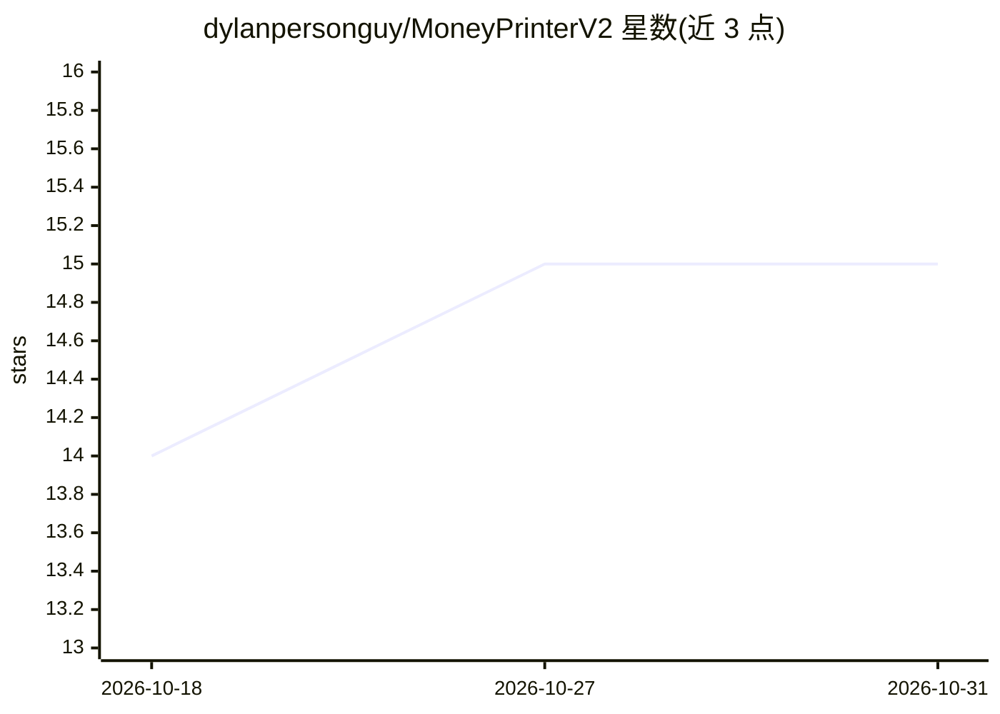

# dylanpersonguy/MoneyPrinterV2

⭐ 15 · Python · AGPL-3.0 · 推送 2026-03-23 · [GitHub](https://github.com/dylanpersonguy/MoneyPrinterV2) · 个人维护

**本地 AI 驱动的在线赚钱自动化工具：短视频/Twitter/营销/邮件外联**

Python 自动化工具集，围绕四条变现工作流：YouTube Shorts 自动生成与上传（Ollama 写脚本、Gemini 生图、KittenTTS 配音、Whisper 字幕、MoviePy 合成、Selenium 上传）、Twitter 机器人、Amazon 联盟营销、本地商户冷邮件外联。文本生成全部走本地 Ollama，除可选图像生成与语音转文字外无需云 API。提供 Flask Web 仪表盘（18 个 REST 端点）与 CLI 两种使用方式，通过 config.json 配置。声明仅供教育用途，需遵守各平台服务条款。为 FujiwaraChoki/MoneyPrinterV2 的分支。

## 筛选速览

| 维度 | 判定 | 备注 |
|---|---|---|
| AI 角色 | `ai-native` | 本体是模型或模型工具 |
| 许可风险 | `viral` | AGPL-3.0 |
| 部署形态 | `None` |  |
| 模型依赖 | local-ok | 支持本地模型 |
| 硬件要求 | — | 无带数字的原话,不猜 |
| 安装摩擦 | `low` | 无编译、无系统依赖或容器化 |
| 成熟度 | — | 结构信号不足 |

## 能力要点

- 四条自动化工作流：短视频、Twitter 机器人、联盟营销、冷邮件外联
- 文本生成使用本地 Ollama，浏览器会话不上云
- Flask Web 仪表盘：账号管理、一键生成、后台任务进度、模型选择器
- 18 个 REST API 端点，支持 CRON 定时发布

## 适用场景

- 批量生成并自动上传 YouTube Shorts
- 定时自动生成和发布推文
- 抓取 Amazon 商品并自动生成带联盟链接的推广内容
- 按行业和地区抓取本地商户并发送冷外联邮件

## 场景标签

`浏览器自动化` `网页抓取` `工作流自动化` `视频生成` · 领域:效率与自动化

## 证据(README 行号)

> L15: MoneyPrinter V2 (MPV2) is a Python automation toolkit that uses **local AI models** (via Ollama) and **browser auto
> L25: - **AI Script Generation** — Ollama generates a spoken script for any niche

## 星数曲线

2026-10-18 14 → 2026-10-31 15（+1）

---
*卡片 v1 · prompt 1.4 · 生成 2026-10-31 · 置信度 high · 依据 README sha `efe5906febfd` · [字段定义](../../DATASET.md)*
