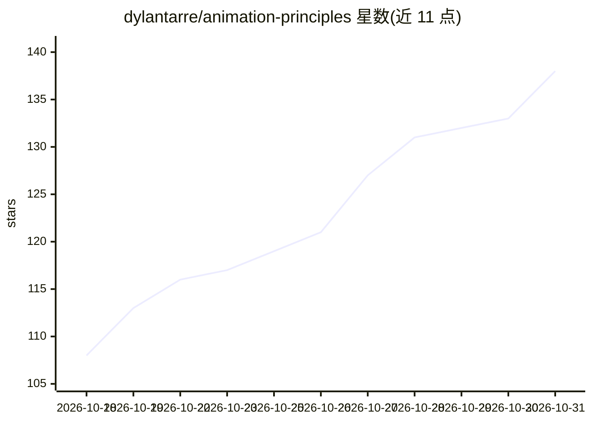

# dylantarre/animation-principles

⭐ 138 · MIT · 推送 2025-12-30 · [GitHub](https://github.com/dylantarre/animation-principles) · 个人维护

**面向 Claude Code 的迪士尼动画十二法则技能集合（144 条）**

一个 Claude Code 技能市场仓库：以 12 条迪士尼动画原则为基础组织 144 个技能（12 组×12），按应用领域（Web/移动/游戏/数据可视化）、角色、技术框架（CSS/Framer Motion/GSAP/Lottie 等）、情绪效果与技能水平分类。每条技能教 Claude 在特定场景应用动画原则（如 joy-delight、fintech-banking、squash-stretch-mastery）。通过 Claude Code 插件配置或 git clone 到插件目录安装，也可在对话中直接引用技能名。内容依据 Johnston 与 Thomas 所著《The Illusion of Life》(1981)。

## 筛选速览

| 维度 | 判定 | 备注 |
|---|---|---|
| AI 角色 | `ai-knowledge` | 知识聚合/清单类 |
| 许可风险 | `permissive` | MIT |
| 部署形态 | `None` |  |
| 模型依赖 | — | README 未给出锁定关系 |
| 硬件要求 | — | 无带数字的原话,不猜 |
| 安装摩擦 | `low` | 无编译、无系统依赖或容器化 |
| 成熟度 | — | 结构信号不足 |

## 能力要点

- 144 个技能按 12 条迪士尼动画原则组织（12 组×12）
- 覆盖 Web/移动/游戏/数据可视化等应用领域与 CSS/GSAP/Framer Motion/Lottie 等框架
- 支持插件配置、手动 clone 与对话内直接引用三种用法
- 按情绪效果与技能水平（入门到教学）分类

## 适用场景

- 让 Claude 在写前端动效时应用动画十二法则
- 为游戏 UI 或微交互设计查找对应动画技能
- 按框架（GSAP/Framer Motion 等）获取针对性的动画实现指导

## 场景标签

`提示工程` · 领域:Agent 开发

## 证据(README 行号)

> L5: A comprehensive collection of 144 Claude Code skills that teach Disney's 12 Principles of Animation and ways to appl
> L13: This is a **skill marketplace** for Claude Code that transforms Claude into a Disney animation expert. Whether you'

## 星数曲线

2026-10-18 108 → 2026-10-31 138（+30）

---
*卡片 v1 · prompt 1.4 · 生成 2026-10-23 · 置信度 high · 依据 README sha `27299a0c09d8` · [字段定义](../../DATASET.md)*
