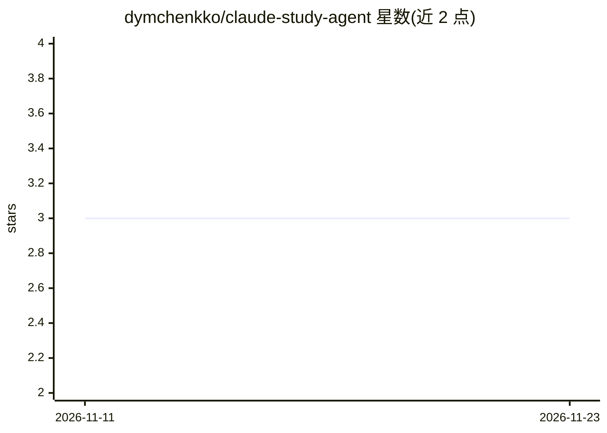

# dymchenkko/claude-study-agent

⭐ 3 · Python · MIT · 推送 2026-11-22 · [GitHub](https://github.com/dymchenkko/claude-study-agent) · [官网](https://dymchenkko.github.io/claude-study-agent/) · 个人维护

**大学生的考试复习 AI 私教：用自己的课件教学并安排复习**

一组 Claude Code 技能（MIT 许可，macOS/Linux，Windows 走 WSL），把本地课件转成可检索文本后开展教学。核心机制：讲解带文件出处引用（页码/时间戳）、按主题的间隔复习（1→3→7→16→35 天）与错题记录、按课程真实题型生成模拟考。本地用 whisper.cpp 转写讲座录音、OCR 读扫描 PDF、可选 EmbeddingGemma 2 + llama.cpp 做离线语义搜索。依赖 Claude Pro/Max 订阅，无需 API key。

## 筛选速览

| 维度 | 判定 | 备注 |
|---|---|---|
| AI 角色 | `ai-native` | 本体是模型或模型工具 |
| 许可风险 | `permissive` | MIT |
| 部署形态 | `library` | 以包/库形式分发 |
| 模型依赖 | locked-api |  |
| 硬件要求 | — | 无带数字的原话,不猜 |
| 安装摩擦 | `medium` | 含编译或系统依赖之一 |
| 成熟度 | — | 结构信号不足 |

## 能力要点

- 讲解附文件出处引用，材料全部本地转换与索引
- 按主题间隔复习与错题追踪，自动安排每日学习计划
- 按课程真实考试格式生成测验与模拟考及薄弱点报告
- whisper.cpp 本地转写录音，可选离线语义搜索（4 GB RAM 即可）

## 适用场景

- 用自己的幻灯片、PDF 和录音复习考试
- 把讲座录像转成带时间戳的文字并检索
- 生成与真实考试格式一致的模拟卷并定位薄弱点
- 跨多门课程统一安排每日复习计划

## 场景标签

`文档问答` `语音识别` · 领域:知识与检索

## 证据(README 行号)

> L3:  An open-source AI study tutor that learns from your own lecture PDFs, slides and recordings.
> L180: An open-source AI tutor for university courses, built as a set of Claude Code skills. You put your lecture slides,

## 星数曲线

2026-11-11 3 → 2026-11-23 3（+0）

---
*卡片 v1 · prompt 1.4 · 生成 2026-11-22 · 置信度 mid · 依据 README sha `070cc979cda9` · [字段定义](../../DATASET.md)*
