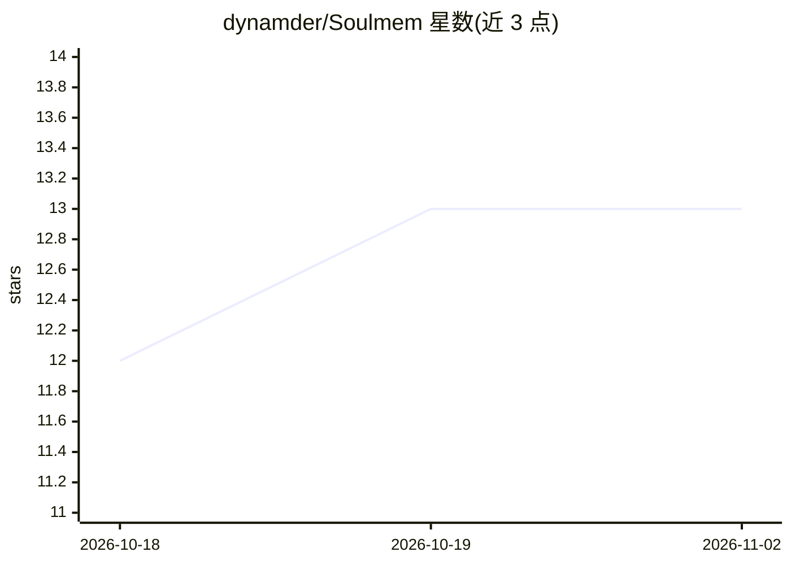

# dynamder/Soulmem

⭐ 13 · Rust · MIT · 推送 2026-11-01 · [GitHub](https://github.com/dynamder/Soulmem) · [官网](https://dynamder.github.io/Soulmem/) · 个人维护 · 中文 README

**面向角色扮演任务的个人级 LLM 记忆系统（Rust）**

用 Rust 编写的记忆系统，专供角色扮演任务使用：让模拟角色像人一样记住情感相关、可驱动行为的事件并建立关联，支持记忆整合与概括、模拟遗忘曲线的主动遗忘、基于图谱的联想、交互中的动态记忆更新及短期上下文摘要。设计哲学为“一切特征和事件都属于记忆”，以记忆演化替代静态角色卡。面向个人用户在家用电脑上运行，非企业级方案。仓库由多个 crate 组成（数据模型、嵌入查询、LLM 调用层、运行时与检索/遗忘算法），附 Flutter GUI 测试工具。当前处于积极开发中，尚未发布稳定版本，main 分支为重构后架构，部分测试需下载 BGE 嵌入模型或本地 GGUF 模型。

## 筛选速览

| 维度 | 判定 | 备注 |
|---|---|---|
| AI 角色 | `ai-ecosystem` | LLM/agent 周边工具 |
| 许可风险 | `permissive` | MIT |
| 部署形态 | `None` |  |
| 模型依赖 | local-ok | 支持本地模型 |
| 硬件要求 | — | 无带数字的原话,不猜 |
| 安装摩擦 | `low` | 无编译、无系统依赖或容器化 |
| 成熟度 | `idea` | |

## 能力要点

- 记忆整合/概括与模拟遗忘曲线的主动遗忘机制
- 基于工作记忆子图的主动联想
- 多 crate 架构：数据模型、嵌入查询、LLM 调用层、运行时、检索/遗忘算法分离
- 提供 Flutter GUI 测试工具（soul-tune）与三平台 CI

## 适用场景

- 角色扮演应用中让 AI 角色拥有会遗忘、会演化的长期记忆
- 替代静态角色卡，驱动角色性格动态演变并保持一致性
- 在家用电脑上本地运行的记忆层集成到 LLM 应用

## 场景标签

`Agent 记忆` · 领域:Agent 开发

## 证据(README 行号)

> L13: SoulMem是一个专为角色扮演任务设计的记忆系统，它**旨在**使LLM的输出更拟人化成为可能，让模拟角色像人一样记住重要的、情感相关的、可驱动行为的事件，并建立关联。**它不旨在**精确无误地记忆事件的细节，或事实性知识。
> L15: **请注意！**：SoulMem是针对于**个人用户**，在**家用电脑**上运行的记忆系统，并非企业级解决方案。
> L55: |`crates/soul-mem-llm`|全仓库唯一的 LLM 调用层（契约 / 传输 / 重试 / 流式 / trace）|

## 星数曲线

2026-10-18 12 → 2026-11-02 13（+1）

---
*卡片 v1 · prompt 1.4 · 生成 2026-11-01 · 置信度 high · 依据 README sha `64a5c16580d2` · [字段定义](../../DATASET.md)*
