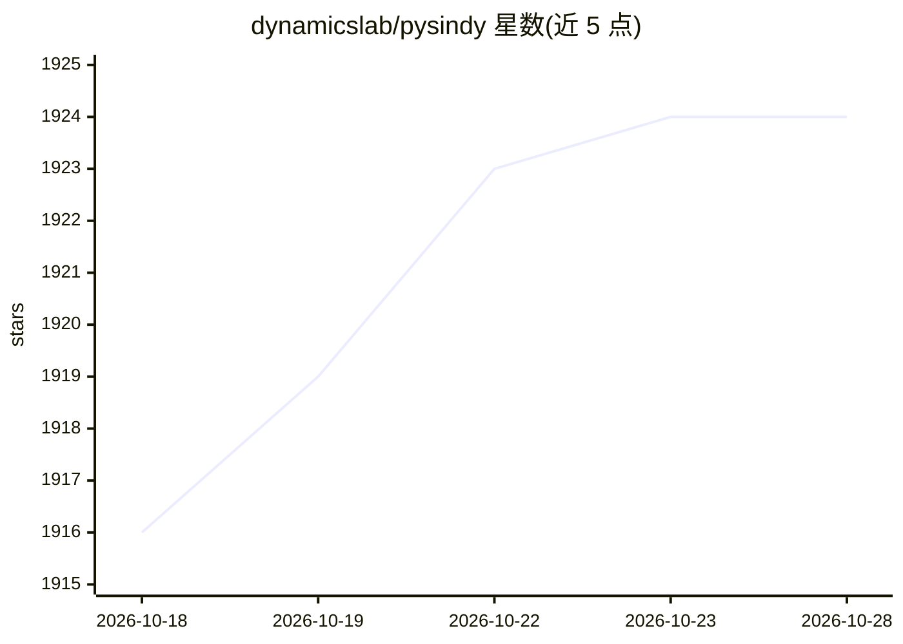

# dynamicslab/pysindy

⭐ 1,925 · Python · NOASSERTION · 推送 2026-10-15 · [GitHub](https://github.com/dynamicslab/pysindy) · [官网](https://pysindy.readthedocs.io/en/latest/) · 组织维护

**从测量数据稀疏辨识非线性动力学方程的 Python 库**

PySINDy 实现系统辨识方法 SINDy（Brunton et al. 2016a）及文献中的相关方法：从时间序列测量数据中推断系统的控制动力学方程，发现的方程可用于预测未来状态、指导控制输入或理论分析，模型具有可解释性。以 Python 包提供，支持 pip/conda 安装，另提供 cvxpy、miosr、sbr 可选优化器组件，配套教程、文档与视频资源。

## 筛选速览

| 维度 | 判定 | 备注 |
|---|---|---|
| AI 角色 | `ai-native` | 本体是模型或模型工具 |
| 许可风险 | `none` | NOASSERTION |
| 部署形态 | `library` | 以包/库形式分发 |
| 模型依赖 | — | README 未给出锁定关系 |
| 硬件要求 | — | 无带数字的原话,不猜 |
| 安装摩擦 | `low` | 无编译、无系统依赖或容器化 |
| 成熟度 | — | 结构信号不足 |

## 能力要点

- 实现 SINDy 方法及文献中相关系统辨识方法
- 从数据中恢复可解释、可泛化的控制方程
- 提供 cvxpy/miosr/sbr 可选优化器扩展
- 配套教程、文档站点与视频讲解

## 适用场景

- 从实验或仿真测量数据中辨识动力学控制方程
- 用发现的方程预测系统未来状态或指导控制
- 学术研究中引用并复现 SINDy 相关结果

## 场景标签

 · 领域:科学计算/动力系统辨识

## 证据(README 行号)

> L5: **PySINDy** is a package for system identification, primarily revolving around the method of
> L10: *System identification* refers to the process of using measurement data to infer the governing dynamics.

## 星数曲线

2026-10-18 1,916 → 2026-10-28 1,924（+8）

---
*卡片 v1 · prompt 1.4 · 生成 2026-10-21 · 置信度 high · 依据 README sha `63438b82fbdc` · [字段定义](../../DATASET.md)*
