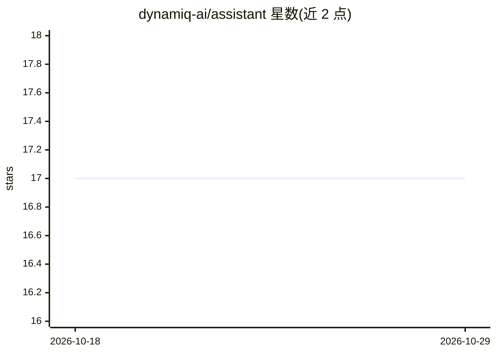

# dynamiq-ai/assistant

⭐ 17 · TypeScript · Apache-2.0 · 推送 2026-10-26 · [GitHub](https://github.com/dynamiq-ai/assistant) · [官网](https://getdynamiq.ai) · 组织维护

**给 Web 开发者的 React/JS 聊天组件，接入 Dynamiq AI agent**

dynamiq-assistant 是面向 React 与原生 JavaScript 的聊天挂件库，用于将 Dynamiq 平台部署的 AI agent 以可定制聊天窗口嵌入网页。通过 npm/yarn 安装组件，填入 Dynamiq 部署生成的 API URL 即可使用；支持流式响应、文件上传（图片/PDF/文档）、Vega 图表渲染、主题定制、位置配置与聊天历史（localStorage 存储）。README 明确说明端点为公开端点，建议生产环境通过后端代理鉴权，并描述了输出净化与资源来源限制等安全机制。

## 筛选速览

| 维度 | 判定 | 备注 |
|---|---|---|
| AI 角色 | `ai-ecosystem` | LLM/agent 周边工具 |
| 许可风险 | `permissive` | Apache-2.0 |
| 部署形态 | `library` | 以包/库形式分发 |
| 模型依赖 | — | README 未给出锁定关系 |
| 硬件要求 | — | 无带数字的原话,不猜 |
| 安装摩擦 | `low` | 无编译、无系统依赖或容器化 |
| 成熟度 | — | 结构信号不足 |

## 能力要点

- React 与原生 JavaScript 双组件形态，亦支持 CDN script 标签引入
- 支持流式响应与中间步骤展示
- 文件上传与 Vega 图表渲染能力
- Bot 输出经 DOMPurify 净化，支持 allowedResourceOrigins 来源限制

## 适用场景

- 在自家网站嵌入 Dynamiq agent 的客服式聊天窗口
- 通过事件回调（onFeedback/onPromptSend 等）对接自有业务逻辑
- 为 agent 回答配置欢迎页、预设 prompts 与主题配色

## 场景标签

`AI 助手` · 领域:对话与助手

## 证据(README 行号)

> L23: **dynamiq-assistant** allows you to seamlessly integrate AI agents into your applications through customizable chat
> L25: Dynamiq is an orchestration framework for agentic AI and LLM applications, enabling businesses to build, deploy, an

## 星数曲线

2026-10-18 17 → 2026-10-29 17（+0）

---
*卡片 v1 · prompt 1.4 · 生成 2026-10-29 · 置信度 high · 依据 README sha `e28d7c18d2f1` · [字段定义](../../DATASET.md)*
