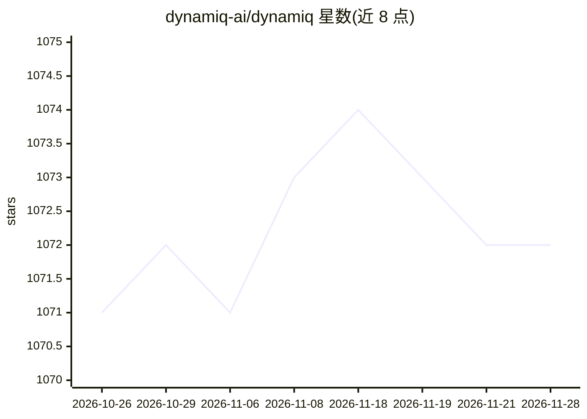

# dynamiq-ai/dynamiq

⭐ 1,072 · Python · Apache-2.0 · 推送 2026-11-27 · [GitHub](https://github.com/dynamiq-ai/dynamiq) · [官网](https://getdynamiq.ai) · 组织维护

**面向开发者的 agentic AI 与 LLM 应用编排框架**

Dynamiq 是一个用于开发 AI 应用的 Python 编排框架，聚焦 RAG 与 LLM agent 的编排。安装基础包即包含 agents、workflows、各 LLM provider、内置工具与记忆、PDF/Word/PPT/Excel 读取；需更大 SDK 的集成以 extras 提供（vectorstores、sql、browser、sandboxes、evals 等）。支持 Workflow 并行/串行 agent 编排、图编排器、带记忆的聊天、检查点暂停恢复、MCP server 工具与代码沙箱，另提供 dynamiq CLI 与官方平台交互。需 Python 3.11–3.14，Apache 2 许可。

## 筛选速览

| 维度 | 判定 | 备注 |
|---|---|---|
| AI 角色 | `ai-ecosystem` | LLM/agent 周边工具 |
| 许可风险 | `permissive` | Apache-2.0 |
| 部署形态 | `library` | 以包/库形式分发 |
| 模型依赖 | — | README 未给出锁定关系 |
| 硬件要求 | — | 无带数字的原话,不猜 |
| 安装摩擦 | `low` | 无编译、无系统依赖或容器化 |
| 成熟度 | — | 结构信号不足 |

## 能力要点

- 基础包内置 agents、workflows、全部 LLM provider、工具与记忆
- 按 extras 组织重型集成：vectorstores/files/sql/browser/sandboxes/evals 等
- 支持 ReAct agent、多 agent 并行/串行 Workflow、Graph Orchestrator
- 提供 dynamiq CLI 部署工作流并管理知识库、数据集与评估

## 适用场景

- 构建 RAG 文档索引与检索问答流水线
- 编排多个协作 agent 完成复杂任务
- 为 agent 挂载代码沙箱与 MCP 工具

## 场景标签

`Agent 框架` `多智能体` `RAG` · 领域:Agent 开发

## 证据(README 行号)

> L3:  Dynamiq is an orchestration framework for agentic AI and LLM applications
> L23: Dynamiq is your all-in-one Gen AI framework, designed to streamline the development of AI-powered applications. Dyn

## 星数曲线

2026-10-26 1,071 → 2026-11-28 1,072（+1）

---
*卡片 v1 · prompt 1.4 · 生成 2026-11-24 · 置信度 high · 依据 README sha `502d62110a0b` · [字段定义](../../DATASET.md)*
