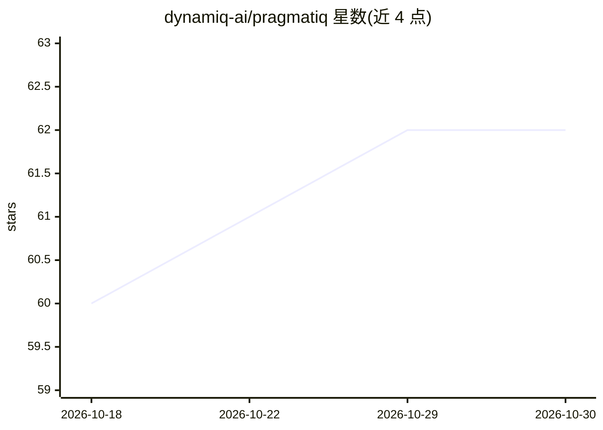

# dynamiq-ai/pragmatiq

⭐ 62 · Python · Apache-2.0 · 推送 2026-09-15 · [GitHub](https://github.com/dynamiq-ai/pragmatiq) · [官网](https://pragmatiq.getdynamiq.ai) · 组织维护

**银行业行为基础模型开源实现：把用户事件史转为嵌入并支持下游任务**

PRAGMA 论文（arXiv:2604.08649）的独立开源实现，面向研究人员、ML 工程师与数据科学家。将带时间戳的键值事件用户史转为嵌入，供探针评估、LoRA 微调、GraphSAGE 反洗钱图实验与 ONNX/Triton 服务使用。仓库包含确定性合成银行数据生成器、键-值-时间分词器、PyTorch 模型、训练管线、批量嵌入与 Streamlit 演示。GPU 优先（bf16、可选 flash-attn varlen 内核）且 CPU 完整支持（fp32，命令与输出契约相同）。Python 3.11+、torch 2.6+，Apache-2.0 许可。

## 筛选速览

| 维度 | 判定 | 备注 |
|---|---|---|
| AI 角色 | `ai-native` | 本体是模型或模型工具 |
| 许可风险 | `permissive` | Apache-2.0 |
| 部署形态 | `self-host` | docker 或自建部署 |
| 模型依赖 | — | README 未给出锁定关系 |
| 硬件要求 | `cpu-ok` | |
| 安装摩擦 | `low` | 无编译、无系统依赖或容器化 |
| 成熟度 | — | 结构信号不足 |

## 能力要点

- 合成银行数据生成→分词→预训练→嵌入→探针评估的端到端 quickstart
- GPU 优先且 CPU 完整支持：同一命令同一输出契约
- GraphSAGE 转账图反洗钱消融与多任务探针基准
- ONNX/Triton 服务导出与 LoRA 微调

## 适用场景

- 在银行用户行为数据上训练嵌入并做信用风险/流失探针评估
- 复现与改编 PRAGMA 论文的实现路径
- 做基于转账图的反洗钱图神经网络实验
- 嵌入生产部署（ONNX/Triton）

## 场景标签

`模型训练` `微调` · 领域:训练与推理

## 证据(README 行号)

> L14: Ostroukhov et al. It turns user histories made of timestamped key-value events
> L15: into embeddings that downstream teams can use for probes, LoRA fine-tuning,
> L39: pragmatiq provides an open implementation that researchers, ML engineers, and

## 星数曲线

2026-10-18 60 → 2026-10-30 62（+2）

---
*卡片 v1 · prompt 1.4 · 生成 2026-10-24 · 置信度 mid · 依据 README sha `96e566152a46` · [字段定义](../../DATASET.md)*
