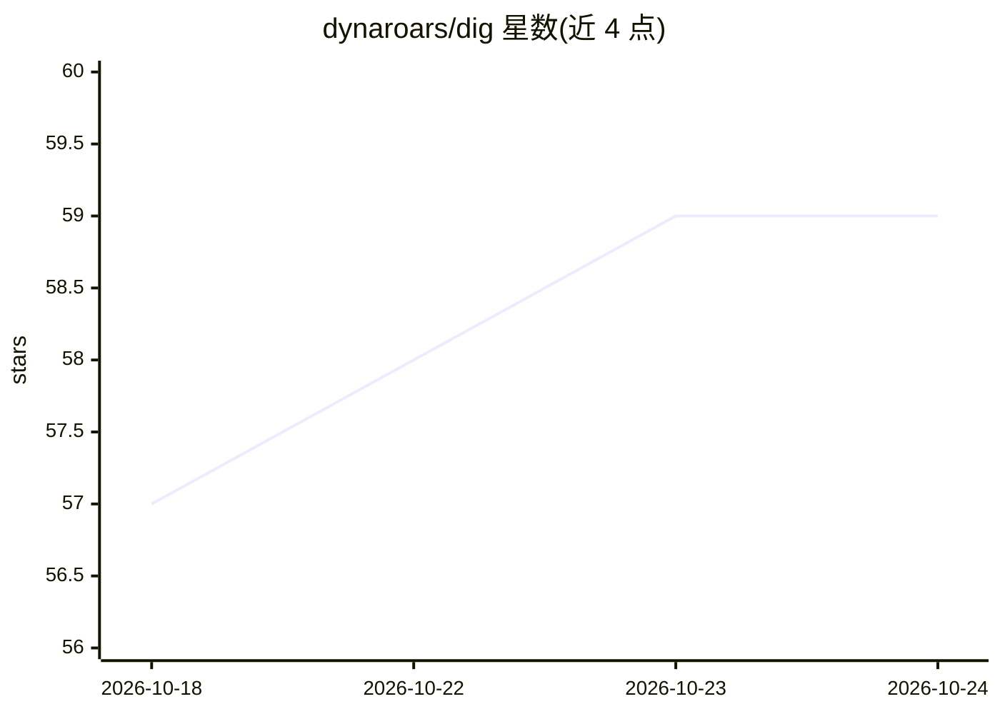

# dynaroars/dig

⭐ 59 · Python · MIT · 推送 2026-10-09 · [GitHub](https://github.com/dynaroars/dig) · [官网](https://dig.roars.dev/) · 个人维护

**数值程序不变式生成工具：从 C 程序或执行轨迹推断程序性质**

面向程序验证研究者的不变式（invariant）生成工具：读取带位置标注的 C 程序或 csv 执行轨迹，用内置 Python 符号执行引擎收集符号状态，经 Z3 检查，按迭代猜测-检验（CEGIR）方式推断数值不变式，覆盖非线性等式、区间/八角不等式、min/max 析取、同余与数组关系等。默认不使用 ML；可选实验性 LLM 模式仅提出候选，最终仍由符号状态+Z3 验证保证可靠性。提供 Docker 安装与在线试用地址。

## 筛选速览

| 维度 | 判定 | 备注 |
|---|---|---|
| AI 角色 | `ai-enhanced` | 去掉 AI 部分产品仍成立 |
| 许可风险 | `permissive` | MIT |
| 部署形态 | `self-host` | docker 或自建部署 |
| 模型依赖 | — | README 未给出锁定关系 |
| 硬件要求 | — | 无带数字的原话,不猜 |
| 安装摩擦 | `low` | 无编译、无系统依赖或容器化 |
| 成熟度 | — | 结构信号不足 |

## 能力要点

- 支持非线性等式、八角/区间不等式、min/max 析取、同余与嵌套数组关系
- 符号执行收集符号状态并用 Z3 验证候选不变式，反例驱动的迭代猜测-检验
- 可选实验性 LLM 模式：LLM 仅提议候选，可靠性不依赖 LLM，输出仍经 Z3 验证
- 产生 dig-nla 等基准，被 SV-COMP 竞赛采用

## 适用场景

- 在循环头或函数出口等任意位置自动推断循环不变式与后置条件
- 从程序执行轨迹做纯动态不变式挖掘
- 借助 LLM 提议再经 Z3 验证获得代数引擎不覆盖的不变式形式

## 场景标签

 · 领域:软件工程/程序验证

## 证据(README 行号)

> L5: **DIG** is an _invariant generation_ tool that discovers program properties at _arbitrary_ program locations (e.g., 
> L225:  - By default, does not use ML for inference (no LLMs, classifers, etc); an optional, experimental LLM mode can *p
> L226: - DIG follows an _iterative guess-and-check approach_, which infers candidate invs from traces, checks and obtains

## 星数曲线

2026-10-18 57 → 2026-10-24 59（+2）

---
*卡片 v1 · prompt 1.4 · 生成 2026-10-24 · 置信度 mid · 依据 README sha `411a3b7562ba` · [字段定义](../../DATASET.md)*
