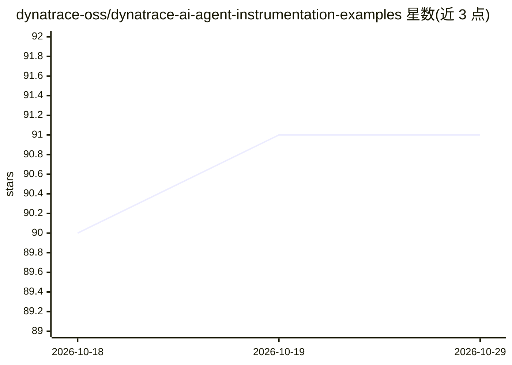

# dynatrace-oss/dynatrace-ai-agent-instrumentation-examples

⭐ 91 · Python · Apache-2.0 · 推送 2026-10-28 · [GitHub](https://github.com/dynatrace-oss/dynatrace-ai-agent-instrumentation-examples) · [官网](https://www.dynatrace.com/solutions/ai-observability/) · 组织维护

**Dynatrace AI agent 可观测性 OTel 埋点示例集**

Dynatrace 官方维护的示例仓库，演示如何为 AI agent 与 LLM SDK 埋点以实现 Agentic AI 工作负载的可观测性：监控 agent 执行、工具调用、prompt/响应链路、token 消耗与成本。遥测可经 OneAgent、OpenTelemetry SDK 或 OTel Collector（含 Dynatrace 发行版）上报。覆盖 10 个模型 provider SDK、14 个 agent 框架与 10 个 AI 编码 agent（零代码改动）的示例，每个示例用 make install/run/request 统一运行。

## 筛选速览

| 维度 | 判定 | 备注 |
|---|---|---|
| AI 角色 | `ai-ecosystem` | LLM/agent 周边工具 |
| 许可风险 | `permissive` | Apache-2.0 |
| 部署形态 | `None` |  |
| 模型依赖 | local-ok | 支持本地模型 |
| 硬件要求 | — | 无带数字的原话,不猜 |
| 安装摩擦 | `medium` | 含编译或系统依赖之一 |
| 成熟度 | — | 结构信号不足 |

## 能力要点

- 覆盖 10 个模型 provider SDK 的埋点示例（OneAgent/OpenInference/OTel 三通道）
- 支持 CrewAI、LangGraph、LlamaIndex、MCP 等 14 个 agent 框架
- AI 编码 agent（Claude Code、Cursor 等 10 个）基于内置 OTel 信号零代码接入
- 内置 LLM 评估：忠实度、PII 泄露、偏见、上下文相关性等

## 适用场景

- 为生产环境的 AI agent 添加性能与成本监控
- 追踪 agent 的 prompt 流、工具调用与服务依赖链路
- 观察团队内 AI 编码 agent 的 token 消耗与行为

## 场景标签

`LLM 可观测性` · 领域:评测与运维

## 证据(README 行号)

> L5: This project demonstrates how to instrument AI agents with Dynatrace to gain observability into Agentic AI workloads
> L7: By integrating Dynatrace with AI agents, developers can monitor agent execution, understand tool interactions, trace

## 星数曲线

2026-10-18 90 → 2026-10-29 91（+1）

---
*卡片 v1 · prompt 1.4 · 生成 2026-10-23 · 置信度 high · 依据 README sha `c68897ed0688` · [字段定义](../../DATASET.md)*
