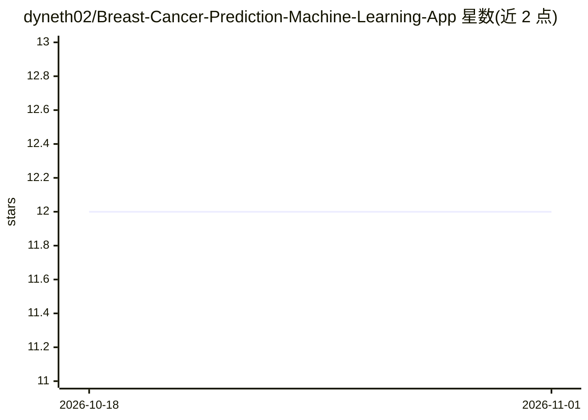

# dyneth02/Breast-Cancer-Prediction-Machine-Learning-App

⭐ 12 · Python · MIT · 推送 2026-01-23 · [GitHub](https://github.com/dyneth02/Breast-Cancer-Prediction-Machine-Learning-App) · 个人维护

**基于细胞学测量的乳腺癌良性/恶性预测 Streamlit 应用**

端到端机器学习应用：使用 Wisconsin 乳腺癌数据集训练逻辑回归模型（含 StandardScaler 特征缩放与数据清洗），序列化后由 Streamlit 网页加载。用户通过滑块输入 30 余项细胞核测量值，获得实时良恶性预测及概率输出，并用 Plotly 雷达图对比均值、标准误与最差值。面向医疗 AI 演示/教学场景，需 Python 3.8+ 环境从源码运行。

## 筛选速览

| 维度 | 判定 | 备注 |
|---|---|---|
| AI 角色 | `ai-native` | 本体是模型或模型工具 |
| 许可风险 | `permissive` | MIT |
| 部署形态 | `library` | 以包/库形式分发 |
| 模型依赖 | — | README 未给出锁定关系 |
| 硬件要求 | — | 无带数字的原话,不猜 |
| 安装摩擦 | `low` | 无编译、无系统依赖或容器化 |
| 成熟度 | — | 结构信号不足 |

## 能力要点

- 逻辑回归 + StandardScaler 的训练与序列化流程
- 30+ 测量值滑块输入的实时预测与概率输出
- Plotly 雷达图对比均值/标准误/最差值三组特征

## 适用场景

- 输入细胞核测量值查看良恶性预测结果
- 重新训练模型并查看准确率与分类报告
- 作为医疗数据科学 Streamlit 应用示例运行

## 场景标签

`数据分析` · 领域:效率与自动化

## 证据(README 行号)

> L4: An end-to-end machine learning application for breast cancer diagnosis that predicts whether a breast mass is benign
> L11: - Logistic Regression classification model

## 星数曲线

2026-10-18 12 → 2026-11-01 12（+0）

---
*卡片 v1 · prompt 1.4 · 生成 2026-11-01 · 置信度 high · 依据 README sha `7173be189251` · [字段定义](../../DATASET.md)*
