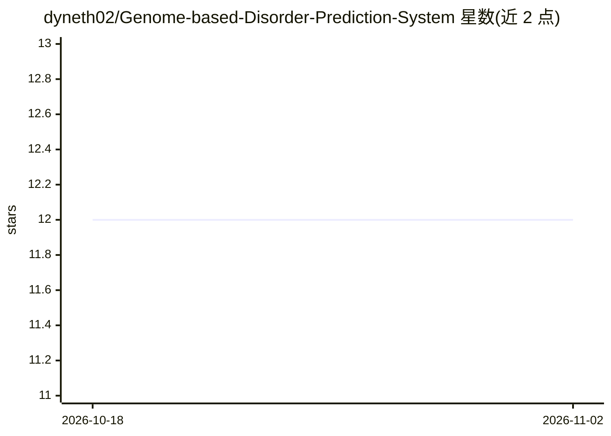

# dyneth02/Genome-based-Disorder-Prediction-System

⭐ 12 · JavaScript · 推送 2026-01-02 · [GitHub](https://github.com/dyneth02/Genome-based-Disorder-Prediction-System) · 个人维护

**预测遗传疾病及子类的两级机器学习系统（附 Web 应用）**

基于基因组、临床与人口学数据的机器学习系统，采用两阶段分层预测管线：父级模型分类遗传疾病大类（随机森林+SMOTE），子级模型利用父级概率作特征预测疾病子类。实现预处理、特征选择与多模型分类（RF、XGBoost、LightGBM、CatBoost 等），以 5 折交叉验证评估，报告整体准确率 84.5%。提供 FastAPI 后端与 React 前端的全栈部署，用户通过表单输入患者数据获得风险预测与类别概率。面向数据驱动的遗传风险评估场景。

## 筛选速览

| 维度 | 判定 | 备注 |
|---|---|---|
| AI 角色 | `ai-native` | 本体是模型或模型工具 |
| 许可风险 | `none` | — |
| 部署形态 | `library` | 以包/库形式分发 |
| 模型依赖 | — | README 未给出锁定关系 |
| 硬件要求 | — | 无带数字的原话,不猜 |
| 安装摩擦 | `low` | 无编译、无系统依赖或容器化 |
| 成熟度 | — | 结构信号不足 |

## 能力要点

- 两阶段分层预测：遗传疾病大类 → 疾病子类
- 多模型集成：Random Forest、XGBoost、LightGBM、CatBoost 等
- 5 折交叉验证与 RandomizedSearchCV 调参，输出准确率/ROC-AUC 等指标
- FastAPI + React 全栈 Web 应用，提供 /api/predict 接口与概率输出

## 适用场景

- 输入患者数据获得遗传疾病及子类的风险预测
- 复现或重训遗传疾病分类模型管线
- 作为生物信息学课程/学术项目参考实现

## 场景标签

 · 领域:生物信息学/医疗健康分析

## 证据(README 行号)

> L4: A comprehensive machine learning system for predicting genetic disorders and their specific subclasses using advance
> L27: - **Primary Algorithm**: Optimized Random Forest with SMOTE

## 星数曲线

2026-10-18 12 → 2026-11-02 12（+0）

---
*卡片 v1 · prompt 1.4 · 生成 2026-11-01 · 置信度 high · 依据 README sha `28d5105d4354` · [字段定义](../../DATASET.md)*
