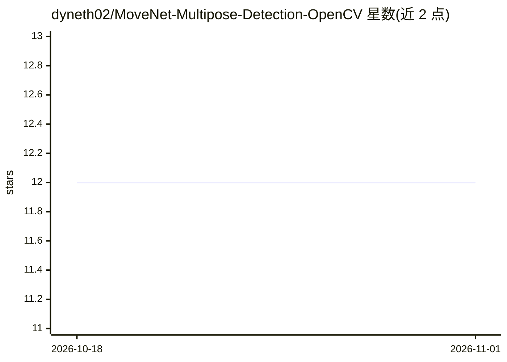

# dyneth02/MoveNet-Multipose-Detection-OpenCV

⭐ 12 · Jupyter Notebook · MIT · 推送 2026-01-02 · [GitHub](https://github.com/dyneth02/MoveNet-Multipose-Detection-OpenCV) · 个人维护

**基于 MoveNet Multipose 的实时多人姿态估计系统**

使用 TensorFlow MoveNet Multipose (Lightning) 模型与 OpenCV 构建的实时多人人体姿态估计管线：从视频文件或摄像头流中检测每帧最多 6 人的 17 个解剖学关键点，输出 (x, y, 置信度)，并渲染骨架连接。模型采用 MobileNetV2 骨干（深度乘数 1.75）、FPN 解码器与 CenterNet 式预测头。支持基于置信度的关键点过滤，GPU 加速为可选且可用时自动配置。以 Python 项目形式提供，未给出安装命令细节。

## 筛选速览

| 维度 | 判定 | 备注 |
|---|---|---|
| AI 角色 | `ai-native` | 本体是模型或模型工具 |
| 许可风险 | `permissive` | MIT |
| 部署形态 | `None` |  |
| 模型依赖 | — | README 未给出锁定关系 |
| 硬件要求 | — | 无带数字的原话,不猜 |
| 安装摩擦 | `low` | 无编译、无系统依赖或容器化 |
| 成熟度 | — | 结构信号不足 |

## 能力要点

- MoveNet Multipose Lightning 模型，每帧最多检测 6 人、每人 17 个关键点
- 支持视频文件与摄像头实时输入
- 置信度阈值可调的关键点过滤
- GPU 加速可选，可用时自动配置

## 适用场景

- 对视频或摄像头画面做实时多人姿态检测与骨架可视化
- 体育运动动作分析
- 手势识别或人机交互的原型开发

## 场景标签

`目标检测` · 领域:感知与多模态

## 证据(README 行号)

> L3: A real-time multi-person human pose estimation system built using **TensorFlow MoveNet Multipose (Lightning)** and *
> L7: This project implements a **real-time multi-person pose estimation pipeline** capable of detecting multiple humans s

## 星数曲线

2026-10-18 12 → 2026-11-01 12（+0）

---
*卡片 v1 · prompt 1.4 · 生成 2026-11-01 · 置信度 high · 依据 README sha `439c78f6523a` · [字段定义](../../DATASET.md)*
